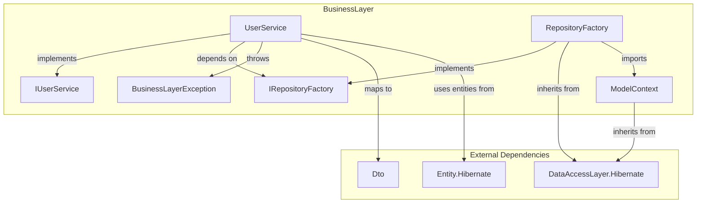

### Purpose

The `BusinessLayer` project contains the application's domain logic, specifically handling user management and database session management. It sits between the UI (view models) and the data access layer, ensuring that higher-level components do not need to know about NHibernate or specific database implementations. The files belong together because they form a closed MEF (Managed Extensibility Framework) composition unit: they define the interfaces for services and repositories, provide concrete implementations wired via attributes, and handle errors specific to this layer.

### Software Components

The logic is split into two main responsibilities: service execution and persistence setup.

*   **User Service:** The [UserService](BusinessLayer/UserService.md) is the primary business logic component. It implements [IUserService](BusinessLayer/IUserService.md) to handle user queries and creation. It uses [IRepositoryFactory](BusinessLayer/IRepositoryFactory.md) to access data and wraps failures in a [BusinessLayerException](BusinessLayer/BusinessLayerException.md).
*   **Repository Infrastructure:** The [RepositoryFactory](BusinessLayer/RepositoryFactory.md) manages the NHibernate session factory. It acts as a thin wrapper around the generic Hibernate factory, fixing the key type to `int`. It relies on [ModelContext](BusinessLayer/ModelContext.md) to retrieve the connection string and mapping assemblies from configuration.
*   **Contracts and Context:** [IRepositoryFactory](BusinessLayer/IRepositoryFactory.md) and [ModelContext](BusinessLayer/ModelContext.md) define the abstract boundaries. [ModelContext](BusinessLayer/ModelContext.md) is a simple MEF export that reads configuration values and passes them to the repository factory.

### Relationships

The components are wired together using MEF attributes rather than manual dependency injection. [RepositoryFactory](BusinessLayer/RepositoryFactory.md) imports [ModelContext](BusinessLayer/ModelContext.md) during construction to get its configuration. [UserService](BusinessLayer/UserService.md) imports [IRepositoryFactory](BusinessLayer/IRepositoryFactory.md) to open a new repository instance for each operation. When [UserService](BusinessLayer/UserService.md) encounters an error, it throws [BusinessLayerException](BusinessLayer/BusinessLayerException.md), which the UI layer can catch specifically to handle business logic failures.

### Rough edges

The `LoggingService` property in [UserService](BusinessLayer/UserService.md) is not injected via MEF (missing `[Import]`), so it defaults to null and will cause a `NullReferenceException` if an error occurs before the host explicitly sets it. Additionally, the `GetActiveUsers` method in [UserService](BusinessLayer/UserService.md) does not actually filter for active users, returning all users despite its name.

## Contents
- [BusinessLayer.csproj](BusinessLayer/BusinessLayer.md)
- [BusinessLayerException.cs](BusinessLayer/BusinessLayerException.md)
- [IRepositoryFactory.cs](BusinessLayer/IRepositoryFactory.md)
- [IUserService.cs](BusinessLayer/IUserService.md)
- [ModelContext.cs](BusinessLayer/ModelContext.md)
- [RepositoryFactory.cs](BusinessLayer/RepositoryFactory.md)
- [UserService.cs](BusinessLayer/UserService.md)