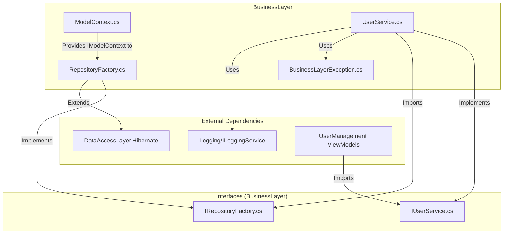

### Purpose

The `BusinessLayer` package acts as the application’s service layer, isolating business rules from data access and UI concerns. It contains the concrete implementations for user management services, the specific configuration required to connect to the database via NHibernate, and the error handling contract for business failures. These components reside together because they share a common composition root via MEF (Managed Extensibility Framework) and form a self-contained logical unit that transforms DTOs into domain entities and vice versa.

### Software Components

The package is structured around a few key responsibilities:

**Service Implementation**
`UserService` (`BusinessLayer/UserService.cs`) is the primary business logic component. It implements [IUserService](BusinessLayer/IUserService.md), handling operations like `GetActiveUsers` and `AddUser`. It depends on the repository factory to persist data and uses [BusinessLayerException](BusinessLayer/BusinessLayerException.md) to standardize error reporting to the UI layer.

**Data Access Wiring**
`RepositoryFactory` (`BusinessLayer/RepositoryFactory.cs`) bridges the business layer to the data access layer. It is a thin MEF-exported class that extends a generic NHibernate factory, closing it to `int` keys. It relies on `ModelContext` to provide connection details and mapping assembly names. The contract for this factory is defined in [IRepositoryFactory](BusinessLayer/IRepositoryFactory.md).

**Configuration Context**
`ModelContext` (`BusinessLayer/ModelContext.cs`) provides the concrete `IModelContext` required by the repository factory. It reads the connection string from application settings and hardcodes the assembly name containing entity mappings. This class essentially configures the NHibernate session factory for this specific application.

**Contracts & Exceptions**
`IUserService` (`BusinessLayer/IUserService.cs`) defines the service interface exposed to view models and tests. [BusinessLayerException](BusinessLayer/BusinessLayerException.md) serves as the specific exception type for business rule violations or service failures, allowing callers to distinguish business errors from framework errors.

### Relationships

The components within `BusinessLayer` are wired together via MEF composition. `ModelContext` exports an `IModelContext`, which is imported by `RepositoryFactory`. `RepositoryFactory` then exports `IRepositoryFactory`, which is imported by `UserService`. Finally, `UserService` exports `IUserService`, which is consumed by the UI layer (`UserManagement` view models) and the test project.

`UserService` depends on `IRepositoryFactory` for data access and `ILoggingService` for logging. While `IRepositoryFactory` is injected via the constructor, `ILoggingService` is a property on the `IUserService` interface that is expected to be populated by the composition container. This property-based injection is a point of fragility, as the code does not guarantee initialization before use.

The data flow starts when a view model calls `IUserService`. `UserService` then uses the repository factory to create a transient repository, executes the database operation, and returns a `UserDto`. If an error occurs during persistence, it is wrapped in `BusinessLayerException` and propagated back to the caller.

### Rough edges

*   `ModelContext` uses a C# 12 primary constructor syntax that appears syntactically invalid or unusual for its base class inheritance, raising concerns about whether it compiles as written.
*   `UserService.AddUser` validates input using `Guard`, which throws `ArgumentException`, but the method's intent (and catch block) is to only throw `BusinessLayerException`. This means validation errors bypass the intended error handling contract.
*   `GetActiveUsers` in `UserService` does not filter by `IsActive` despite the method name, returning all users instead.
*   The `LoggingService` property on `IUserService` is initialized to `null!` in `UserService` and relies on MEF property injection to be set before use. If injection fails or is delayed, an `AddUser` error will cause a `NullReferenceException` instead of a handled business error.

## Contents
- [BusinessLayerException.cs](BusinessLayer/BusinessLayerException.md)
- [IRepositoryFactory.cs](BusinessLayer/IRepositoryFactory.md)
- [IUserService.cs](BusinessLayer/IUserService.md)
- [ModelContext.cs](BusinessLayer/ModelContext.md)
- [RepositoryFactory.cs](BusinessLayer/RepositoryFactory.md)
- [UserService.cs](BusinessLayer/UserService.md)