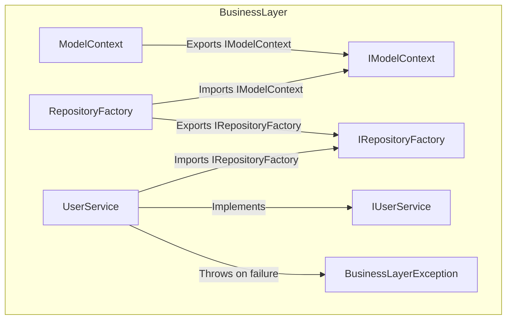

### Purpose

The `BusinessLayer` project serves as the application's business logic layer and the root for MEF (Managed Extensibility Framework) composition. It defines the contracts and concrete services for user management, decoupling the presentation layer (WPF, WinForms) from data access details. The contents belong together because they form a cohesive dependency injection graph: configuration providers (`ModelContext`), data access factories (`RepositoryFactory`), and domain services (`UserService`) are wired together via interfaces to expose high-level operations to the UI.

### Software Components

The directory contains three primary functional groups:

1.  **Domain Services:** `UserService.cs` implements the `IUserService` contract defined in `IUserService.cs`. It handles the core business logic for retrieving and creating users, translating between DTOs and NHibernate entities, and managing transactions.
2.  **Infrastructure Wiring:** `RepositoryFactory.cs` and `ModelContext.cs` handle the bootstrap of data access. `RepositoryFactory` is the MEF-exported factory that produces NHibernate repositories, while `ModelContext` supplies the connection string and mapping assemblies required to initialize that factory.
3.  **Error Contract:** `BusinessLayerException.cs` defines the standard exception type for business failures, allowing upper layers to distinguish business logic errors from data access or UI exceptions.

### Relationships

The components in this directory are tightly coupled through MEF imports and exports. `ModelContext` exports `IModelContext`, which `RepositoryFactory` imports via its constructor to configure NHibernate. `RepositoryFactory` then exports `IRepositoryFactory`, which `UserService` imports to create repositories for database operations. Finally, `UserService` exports `IUserService`, making it available to the view models in the presentation layers.

### Rough edges

- `UserService.GetActiveUsers` ignores the `IsActive` filter despite its name, returning all users.
- `UserService` initializes `LoggingService` to `null!`, causing a `NullReferenceException` in `AddUser`'s error handling if MEF property injection does not occur before use.
- `RepositoryFactory` throws an exception if constructed twice in the same process, preventing runtime re-initialization of the data access layer.

## Contents
- [BusinessLayerException.cs](BusinessLayer/BusinessLayerException.md)
- [IRepositoryFactory.cs](BusinessLayer/IRepositoryFactory.md)
- [IUserService.cs](BusinessLayer/IUserService.md)
- [ModelContext.cs](BusinessLayer/ModelContext.md)
- [RepositoryFactory.cs](BusinessLayer/RepositoryFactory.md)
- [UserService.cs](BusinessLayer/UserService.md)