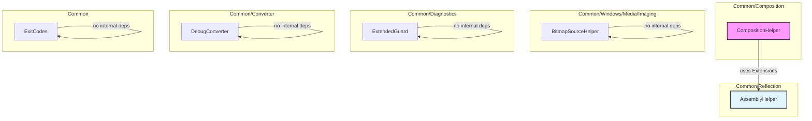

### Purpose

The `Common` package serves as the shared foundation for the solution, housing low-level utilities, composition logic, and interop helpers that are consumed by all application hosts. Its contents belong together because they represent cross-cutting concerns—such as dependency injection bootstrapping, process exit semantics, and Windows-specific graphics conversion—that do not belong to a single feature but are required by the `Mvvm`, `WinForms`, and `Console` applications alike.

### Software Components

This directory contains source code organized into distinct utility clusters, each addressing a specific technical need.

**Composition and Bootstrap**
The [Composition](Common/Composition.md) subdirectory holds the entry-point logic for the application's plugin architecture. [CompositionHelper](Common/Composition/CompositionHelper.md) is the central actor here; it scans the application directory for assemblies and builds a MEF `CompositionContainer`. This allows host applications to resolve modules like `IModuleController` automatically at startup without manual registration.

**Reflection and Metadata**
The [Reflection](Common/Reflection.md) subdirectory provides [AssemblyHelper](Common/Reflection/AssemblyHelper.md), a static class for inspecting assembly metadata and file locations. It handles the verbose `System.Reflection` boilerplate, offering methods to retrieve company/product names and load application icons. Notably, `CompositionHelper` relies on this class to identify which files are valid assemblies.

**Windows Interop and Imaging**
The [Windows](Common/Windows/Media/Imaging.md) subdirectory contains [BitmapSourceHelper](Common/Windows/Media/Imaging/BitmapSourceHelper.md), which bridges GDI+ and WPF imaging formats. It converts `System.Drawing.Bitmap` objects into WPF `BitmapSource` instances and vice versa, handling the unmanaged memory management required for these conversions.

**Diagnostics and Validation**
The [Diagnostics](Common/Diagnostics.md) subdirectory offers [ExtendedGuard](Common/Diagnostics/ExtendedGuard.md), a static utility for argument validation. It complements standard guard clauses with specific collection checks, such as asserting that a list does or does not contain a particular item. This is primarily used by the MVVM layer to enforce view-model registration rules.

**Converter and Exit Codes**
Two standalone files handle specific, isolated responsibilities:
*   [DebugConverter](Common/Converter/DebugConverter.md) in [Converter](Common/Converter.md) is a WPF value converter that triggers a debugger break when invoked. It serves as a diagnostic tool for inspecting data bindings during development.
*   [ExitCodes](Common/ExitCodes.md) defines the static integers used by host applications to signal process termination status (e.g., success vs. failure) to the operating system.

### Relationships

The dependency flow within the `Common` package is largely unidirectional, with utility components supporting the composition bootstrap.

`CompositionHelper` is the most connected component. It depends on `AssemblyHelper` to filter candidate files by extension (`.dll`, `.exe`) before loading them into the MEF container. Once the container is built, the host applications (`Mvvm.Wpf`, `WinFormsApp1`, `ConsoleApp1`) consume it to resolve their module controllers.

`AssemblyHelper` is a leaf node regarding internal dependencies; it relies only on .NET BCLs. However, it is critical to `CompositionHelper` for file discovery and is also used by `Mvvm/MainViewModelBase` to load the application icon.

`BitmapSourceHelper` and `ExtendedGuard` are independent leaves. They do not depend on other `Common` classes. `ExtendedGuard` is called by `ViewModelBase` in the Mvvm layer to validate child view-model registrations. `BitmapSourceHelper` is called by view models that need to display images loaded from GDI+ sources or assembly resources in a WPF context.

`ExitCodes` has no internal dependencies but is consumed by the entry points of `WinFormsApp1` and `Mvvm.Wpf` to define return values on shutdown.

### Rough edges

*   **Version Drift Risk**: The `System.ComponentModel.Composition` package version is pinned in `Common/Common.csproj` and duplicated in at least six other project files. There is no central package management (e.g., `Directory.Packages.props`) to ensure consistency, creating a risk of type-identity mismatches if versions drift.
*   **Resource Leaks in Imaging**: `BitmapSourceHelper.LoadBitmap(Bitmap)` does not call `DeleteObject` to release the GDI handle obtained via `GetHbitmap`, leading to native handle leaks. Similarly, `AssemblyHelper.LoadApplicationIcon` returns an unmanaged `Icon` object that known callers do not dispose.
*   **Invisible Composition Errors**: Errors during assembly loading in `CompositionHelper` are logged to `Console.WriteLine`. In WPF or WinForms hosts, this output is invisible, potentially allowing modules to be silently omitted from the composition container without user-facing errors.
*   **Dead Code in Exit Codes**: The `InsufficientPrivileges` constant in `ExitCodes` is defined but never referenced by any host application, suggesting it is either dead code or reserved for functionality not yet implemented.

## Contents
- [Common.csproj](Common/Common.md)
- [ExitCodes.cs](Common/ExitCodes.md)
- [Composition/](Common/Composition.md)
- [Converter/](Common/Converter.md)
- [Diagnostics/](Common/Diagnostics.md)
- [Reflection/](Common/Reflection.md)
- [Windows/](Common/Windows/Media/Imaging.md)