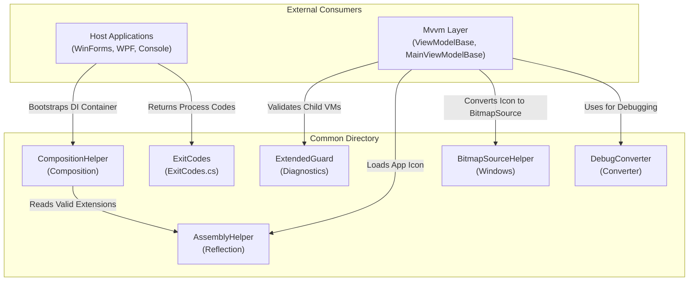

### Purpose

The `Common` directory serves as the shared foundation for the solution's host applications and MVVM libraries. It consolidates cross-cutting utilities that are consumed across different presentation layers (WinForms, WPF, and Console) to ensure consistent behavior.

Its contents belong together because they are low-level, stateless helpers that do not depend on specific business logic or user interface frameworks. By centralizing concerns like dependency composition, assembly reflection, and platform-specific conversions here, the codebase avoids duplicating foundational logic across each individual application project.

### Software Components

The directory is organized into five distinct functional areas, each containing static utility classes:

*   **Composition**: The `CompositionHelper` in `Common/Composition` is the startup bootstrap for the application. It handles assembly discovery and builds the MEF (Managed Extensibility Framework) dependency injection container used by all hosts.
*   **Reflection**: `AssemblyHelper` in `Common/Reflection` centralizes access to assembly metadata (version, company, icon) and defines which file extensions are valid assemblies. It acts as a dependency sink for the composition root.
*   **Diagnostics**: `ExtendedGuard` in `Common/Diagnostics` provides static methods for validating collection membership, specifically supporting the `Mvvm/ViewModelBase` for registering and unregistering child view models.
*   **Windows**: `BitmapSourceHelper` in `Common/Windows` bridges GDI+ and WPF imaging systems, allowing for the conversion of bitmaps and loading of images into WPF-compatible formats.
*   **Converter**: `DebugConverter` in `Common/Converter` implements the WPF `IValueConverter` interface to facilitate runtime debugging of data bindings by logging values and breaking execution.

Additionally, `Common/ExitCodes.cs` defines the standard process exit codes (`Ok`, `Error`, `InsufficientPrivileges`) returned by the executable hosts.

### Relationships

The components within `Common` have minimal internal coupling but serve as critical dependencies for the host applications and MVVM infrastructure.

`CompositionHelper` is the most significant dependency, as the hosts (`WinFormsApp1`, `Mvvm.Wpf`, `ConsoleApp1`) rely entirely on it to initialize their service containers. It depends on `AssemblyHelper` to determine which files in the output directory are valid assemblies to load. In turn, `MainViewModelBase` in the MVVM layer depends on both `AssemblyHelper` (for loading the application icon) and `BitmapSourceHelper` (for converting that icon into a WPF `BitmapSource`).

The hosts also depend directly on `ExitCodes` to standardize their termination signals. While `ExtendedGuard` and `DebugConverter` are used by specific MVVM and WPF components respectively, they are leaf nodes with no internal dependencies.

### Rough edges

*   `ExitCodes.InsufficientPrivileges` is defined but currently unused by any host application in the repository.
*   `DebugConverter` is referenced in `UserView.xaml` but the binding is commented out, rendering the component dormant in the active runtime.
*   `BitmapSourceHelper.LoadBitmap` leaks a native GDI handle on every call, which is a risk if the method is ever used in a loop.
*   `ExtendedGuard` exception messages do not correctly interpolate the argument name, reducing the diagnostic value of the errors thrown.

## Contents
- [ExitCodes.cs](Common/ExitCodes.md)
- [Composition/](Common/Composition.md)
- [Converter/](Common/Converter.md)
- [Diagnostics/](Common/Diagnostics.md)
- [Reflection/](Common/Reflection.md)
- [Windows/](Common/Windows/Media/Imaging.md)