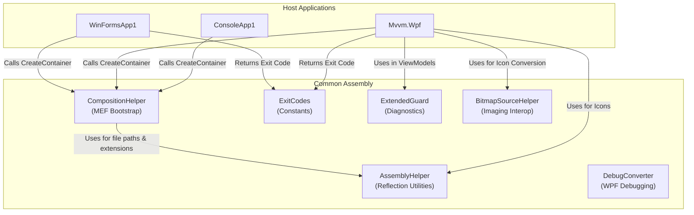

### Purpose

The `Common` directory is the shared utility assembly for the application suite, containing stateless helper classes and configuration constants used by the various host applications (`WinFormsApp1`, `Mvvm.Wpf`, and `ConsoleApp1`). Its primary responsibility is to centralize cross-cutting concerns—specifically dependency injection bootstrapping, system diagnostics, reflection utilities, and platform-specific imaging conversions—so that host applications do not need to duplicate this boilerplate logic.

The contents belong together because they all operate at a low level, providing foundational infrastructure that is independent of specific UI frameworks or business logic. Each subdirectory encapsulates a distinct technical domain, from MEF composition to GDI+ interop, allowing the hosts to reference a single `Common` project for all their shared technical needs.

### Software Components

The components in this directory are organized into distinct functional groups, each serving a specific technical need for the host applications.

*   **Dependency Injection Bootstrap**: The `Composition/` subdirectory contains `CompositionHelper`, which is responsible for initializing the Module-Extension Framework (MEF) container. It scans the output directory for assemblies and builds the catalog that hosts use to resolve `IModuleController` exports.
*   **Process Termination Codes**: The root file `ExitCodes.cs` defines a static class of constants (`Ok`, `Error`, `InsufficientPrivileges`) that standardize the exit codes returned by the host applications to the operating system. This ensures a consistent vocabulary for success and failure across WinForms, WPF, and Console hosts.
*   **Reflection Utilities**: The `Reflection/` subdirectory houses `AssemblyHelper`, a static class that provides methods to inspect loaded assemblies. It handles retrieving file paths, version metadata, and embedded icons, abstracting away the complexity of `System.Reflection` APIs.
*   **Diagnostics and Validation**: The `Diagnostics/` subdirectory contains `ExtendedGuard`, which offers specific precondition checks for collection membership (`Contains`, `NotContains`). This supplements the standard `Guard` library with logic tailored for ViewModel registration scenarios.
*   **WPF Debugging Tools**: The `Converter/` subdirectory provides `DebugConverter`, a value converter intended for debugging WPF data bindings. It allows developers to inspect binding values in the debugger, though it is currently dormant in the codebase.
*   **Platform Imaging Interop**: The `Windows/` subdirectory (specifically `Windows/Media/Imaging`) contains `BitmapSourceHelper`. This class bridges the gap between GDI+ and WPF imaging systems, converting `System.Drawing.Bitmap` objects into WPF `BitmapSource` types for use in the UI.

### Relationships

The dependency flow in `Common` is strictly unidirectional: host applications depend on these components, but the components within `Common` rarely depend on each other, with one notable exception.

The primary internal dependency exists between `Composition/` and `Reflection/`. `CompositionHelper` relies on `AssemblyHelper` to determine valid file extensions (`.dll`, `.exe`) and to locate the application directory when scanning for MEF assemblies. This makes `AssemblyHelper` a foundational leaf node that supports the MEF bootstrapping process.

All other components in `Common` are independent leaf nodes. `ExitCodes`, `ExtendedGuard`, `DebugConverter`, and `BitmapSourceHelper` do not reference other parts of the `Common` project. They are consumed directly by the host applications:
*   The hosts (`WinFormsApp1`, `Mvvm.Wpf`) call `CompositionHelper` during startup to build their DI containers.
*   `Mvvm.Wpf`'s `MainViewModelBase` uses both `AssemblyHelper` (for icons) and `BitmapSourceHelper` (for image conversion) during initialization.
*   `Mvvm`'s `ViewModelBase` uses `ExtendedGuard` for registration logic.

The following diagram illustrates the internal dependency within `Common` and how the hosts interact with these shared components.

### Rough edges

`InsufficientPrivileges` in `ExitCodes.cs` is defined but never referenced by any host, making it dead code. Additionally, `ExtendedGuard` in `Diagnostics/` accepts a `name` parameter for error messages but hard-codes the string literals in the exception, rendering the parameter ineffective for diagnosing which argument failed.

## Contents
- [ExitCodes.cs](Common/ExitCodes.md)
- [Composition/](Common/Composition.md)
- [Converter/](Common/Converter.md)
- [Diagnostics/](Common/Diagnostics.md)
- [Reflection/](Common/Reflection.md)
- [Windows/](Common/Windows/Media/Imaging.md)