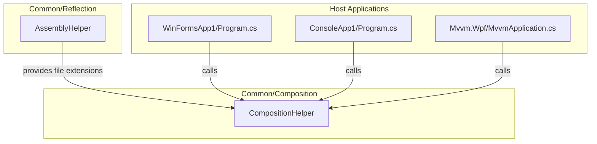

### Purpose

This directory contains the MEF (Managed Extensibility Framework) composition root for the application. It is responsible for discovering loadable assemblies in the output directory and constructing the dependency injection container that all host applications use to resolve services.

The single file here, `CompositionHelper.cs`, belongs in this location because it centralizes the startup bootstrap logic. This ensures that host applications like `WinFormsApp1`, `Mvvm.Wpf`, and `ConsoleApp1` do not need to implement their own assembly scanning or container configuration.

### Software Components

The directory contains one static class, `CompositionHelper`, which acts as the sole entry point for dependency composition. It exposes a single public method, `CreateCompositionContainer`, available in three overloads that funnel into a primary implementation.

This component handles the heavy lifting of runtime assembly resolution. It enumerates files in the executing assembly’s directory, filters out ignored assemblies, loads valid `.dll` and `.exe` files into an `AggregateCatalog`, and finally instantiates a `CompositionContainer`. The resulting container is pre-composed to include itself as an export, allowing nested components to access the dependency resolution service during composition.

### Relationships

`CompositionHelper` has a direct dependency on `Common/Reflection/AssemblyHelper`. Specifically, it uses `AssemblyHelper.Extensions` to determine which file extensions (`.dll` and `.exe`) constitute valid candidate assemblies for loading. This keeps the definition of "loadable file" consistent across the codebase.

The component is consumed exclusively by the host application entry points. `WinFormsApp1/Program.cs` and `ConsoleApp1/Program.cs` use the parameterless or ignore-list overloads, while `Mvvm.Wpf/MvvmApplication.cs` uses the full overload to pass specific module assemblies. Because `CompositionHelper` is the only component that builds the container, these hosts are tightly coupled to its availability. If the helper fails to produce a valid container, host startup breaks, as there is no fallback mechanism for dependency resolution.

### Rough edges

The logic for handling duplicate assemblies is inconsistent. During the initial directory scan, duplicate detection throws an `InvalidOperationException`, but this is immediately caught and logged, effectively treating a critical conflict as a non-fatal warning. However, when loading explicitly named module assemblies later in the process, duplicate detection throws an uncaught exception, which will crash the application startup.

## Contents
- [CompositionHelper.cs](Common/Composition/CompositionHelper.md)