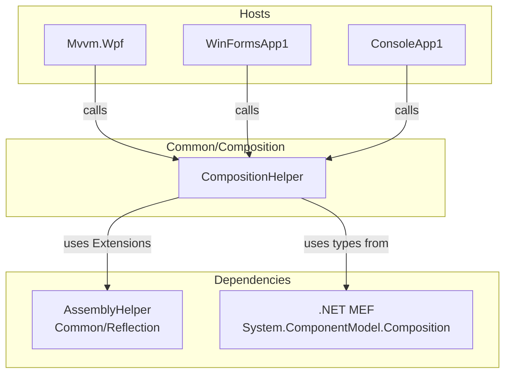

### Purpose

The `Common/Composition` directory serves as the composition bootstrap for the application. It contains the logic required to automatically discover, load, and wire up application modules at startup using MEF (`System.ComponentModel.Composition`). Its single responsibility is to construct a `CompositionContainer` from the available assemblies, allowing host applications to resolve dependencies without manual registration.

### Software Components

This directory contains a single source file: `CompositionHelper.cs`.

*   **`CompositionHelper`**: A static class that exposes the [CreateCompositionContainer](Common/Composition/CompositionHelper.md) method. It handles the enumeration of `.dll` and `.exe` files in the application directory, loads them as assemblies, and aggregates them into a MEF `AggregateCatalog`. It ensures the `Common` and entry-point assemblies are included and returns a configured `CompositionContainer`.

### Relationships

`CompositionHelper` depends on `Common/Reflection/AssemblyHelper` specifically for its `Extensions` constant, which defines the file extensions (`.dll`, `.exe`) used to identify candidate assemblies. It relies entirely on the external .NET MEF namespace (`System.ComponentModel.Composition.Hosting`) for the actual composition logic.

The directory is consumed by the host applications (`Mvvm.Wpf`, `WinFormsApp1`, `ConsoleApp1`). These hosts call `CreateCompositionContainer` during initialization, use the returned container to resolve `IModuleController` or other specific exports, and dispose the container on exit. No other files exist in this directory, so there are no internal sibling dependencies.

### Rough edges

Failures during the assembly loading process (e.g., corrupt files or duplicate assemblies) are logged only to `Console.WriteLine`. In non-console host applications like WPF, this output is invisible, potentially causing modules to be silently missing from the composition container without any user-facing error indication.

## Contents
- [CompositionHelper.cs](Common/Composition/CompositionHelper.md)