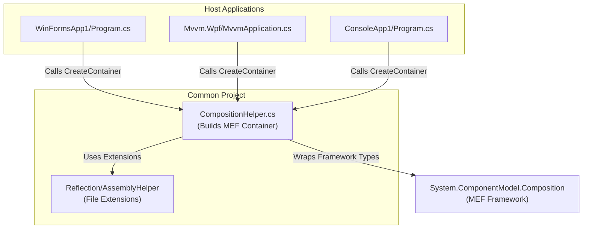

### Purpose

`Common/Composition` is a single-file utility module responsible for bootstrapping the Module-Extension Framework (MEF) dependency injection container for all host applications in the repository. It contains only `CompositionHelper.cs`, which abstracts the complex logic of discovering, loading, and cataloging assemblies so that `WinFormsApp1`, `WpfApp1`, and `ConsoleApp1` can uniformly resolve their `IModuleController` exports. This directory exists to centralize MEF initialization, preventing each host from duplicating assembly-scanning code.

### Software Components

The directory contains one source file:

*   **[CompositionHelper](Common/Composition/CompositionHelper.md)**: A static class exposing `CreateCompositionContainer`. This component enumerates `.dll` and `.exe` files in the application's output directory, loads them into a MEF `AggregateCatalog`, and returns a composed `CompositionContainer`. It handles dependency on `Common.Reflection.AssemblyHelper` for file extension constants and wraps the `System.ComponentModel.Composition` framework.

### Relationships

`CompositionHelper` acts as a foundational bootstrap layer for the repository's host applications. It has a single internal dependency: it uses `Common.Reflection.AssemblyHelper` to determine valid file extensions for assembly discovery. Externally, it wraps the MEF framework types (`CompositionContainer`, `AggregateCatalog`, `AssemblyCatalog`).

The dependency direction is strictly inward toward this helper from the hosts:
1.  **Hosts depend on `CompositionHelper`**: `WinFormsApp1/Program.cs`, `Mvvm.Wpf/MvvmApplication.cs`, and `ConsoleApp1/Program.cs` all call `CreateCompositionContainer` during their startup sequences.
2.  **Container consumers depend on the output**: Once the container is built, hosts resolve `IModuleController` exports (e.g., `DefaultModuleController` classes in the host projects) from it. `CompositionHelper` does not know about these specific controllers; it only ensures the assemblies containing them are loaded and visible to MEF.

### Rough edges

The `ConsoleApp1` host incorrectly passes its own executable name to the `ignoreAssemblies` parameter of `CreateCompositionContainer`, intending to exclude it from cataloging, but the logic adds the entry assembly regardless, rendering the ignore list ineffective in that context. Additionally, the helper uses `Console.WriteLine` for error diagnostics, which is invisible in WPF hosts where no console is attached, potentially masking assembly loading failures.

## Contents
- [CompositionHelper.cs](Common/Composition/CompositionHelper.md)