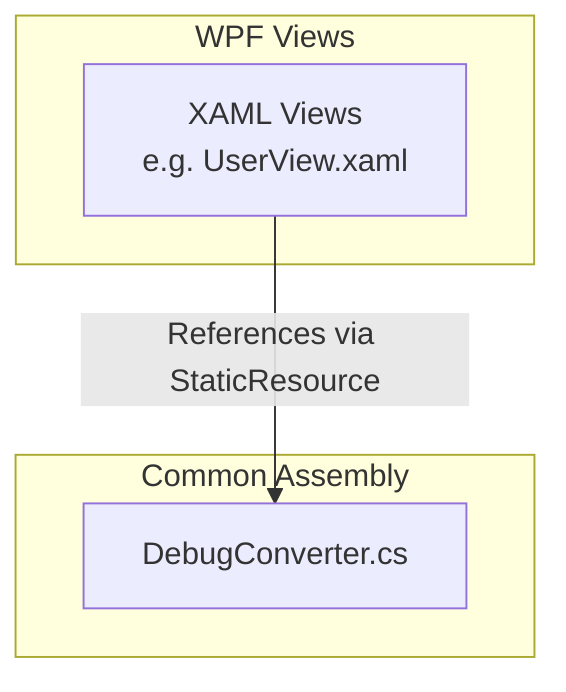

### Purpose

The `Common/Converter` directory contains diagnostic tools for WPF data binding. It currently houses a single utility, `DebugConverter`, designed to help developers inspect values during the binding process.

### Software Components

This directory consists of one source file: `DebugConverter.cs`.

[DebugConverter](Common/Converter/DebugConverter.md) is a class implementing the `IValueConverter` interface. Its primary function is to act as a debugging hook: when a binding uses this converter, the `Convert` method logs the value, target type, and parameter to the debug output and triggers `Debugger.Break()`. The value itself passes through unchanged, allowing the UI to function normally while the developer inspects the state in the debugger.

### Relationships

`DebugConverter` is shared infrastructure living in the `Common` assembly, making it available to all views in the application. It is referenced as a static resource in XAML files, such as `WpfApp1/View/UserView.xaml`.

Currently, no active bindings rely on `DebugConverter` at runtime. In `UserView.xaml`, the resource is declared but the specific `TextBox` binding that uses it is commented out. Therefore, the class is effectively dormant code until a developer manually attaches it to a binding to troubleshoot a specific issue.

## Contents
- [DebugConverter.cs](Common/Converter/DebugConverter.md)