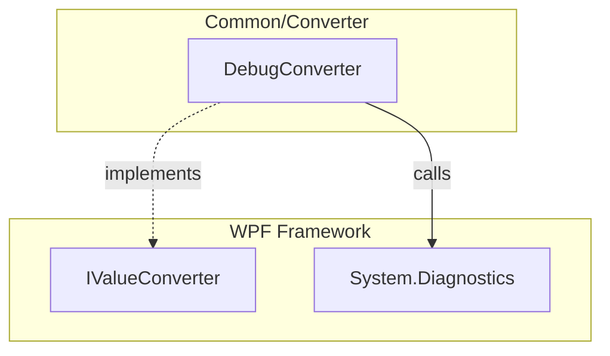

### Purpose

The `Common/Converter` directory contains diagnostic tools for WPF data binding. Specifically, it holds the [DebugConverter.cs](Common/Converter/DebugConverter.md) class, which helps developers inspect values flowing through bindings during debugging. Its sole purpose is to act as a temporary break-point proxy within the view layer.

### Software Components

This directory contains a single source code component: the `DebugConverter` class. It implements the `IValueConverter` interface, allowing it to be instantiated directly in XAML. The class overrides `Convert` to log the incoming value and target type, then triggers a debugger break. The `ConvertBack` method simply passes the value through without side effects. It is not a production converter; both directions eventually return the original value unchanged.

### Relationships

`DebugConverter` sits between the view's XAML markup and the underlying data source. It is referenced by static resource keys in WPF views (such as `WpfApp1/View/UserView.xaml`) rather than being called programmatically. There are no internal dependencies within this directory. Externally, it depends on `System.Windows.Data` for the interface and `System.Diagnostics` for the logging and break functionality. It does not depend on other files in this folder.

## Contents
- [DebugConverter.cs](Common/Converter/DebugConverter.md)