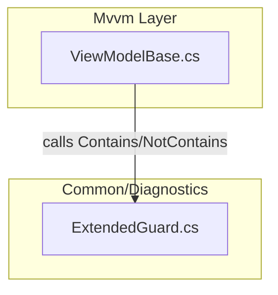

### Purpose

This directory provides shared argument-validation helpers for the codebase. It contains `ExtendedGuard.cs`, a static utility that complements third-party guard libraries by adding collection-containment checks.

### Software Components

The directory contains a single source file: `ExtendedGuard.cs`. This file defines the static class `ExtendedGuard`, which exposes two generic methods for validating collection state.

*   [ExtendedGuard](Common/Diagnostics/ExtendedGuard.md): A static class providing precondition checks for collections.
    *   `Contains<T>`: Asserts that a collection includes a specific item.
    *   `NotContains<T>`: Asserts that a collection does *not* include a specific item.

### Relationships

`ExtendedGuard` is a leaf dependency; it relies only on the standard `System.Collections.Generic` namespace and has no internal dependencies. Its primary consumer is the Mvvm layer, specifically `Mvvm/ViewModelBase.cs`. `ViewModelBase` uses these guards to enforce strict bookkeeping rules for child view models: `RegisterChildViewModel` calls `NotContains` to prevent double-registration, while `UnregisterChildViewModel` calls `Contains` to prevent unregistering a model that was never registered.

### Rough edges

The error messages thrown by `ExtendedGuard` hard-code a placeholder string instead of interpolating the passed `name` argument, so the exception message does not identify the specific item that caused the validation failure.

## Contents
- [ExtendedGuard.cs](Common/Diagnostics/ExtendedGuard.md)