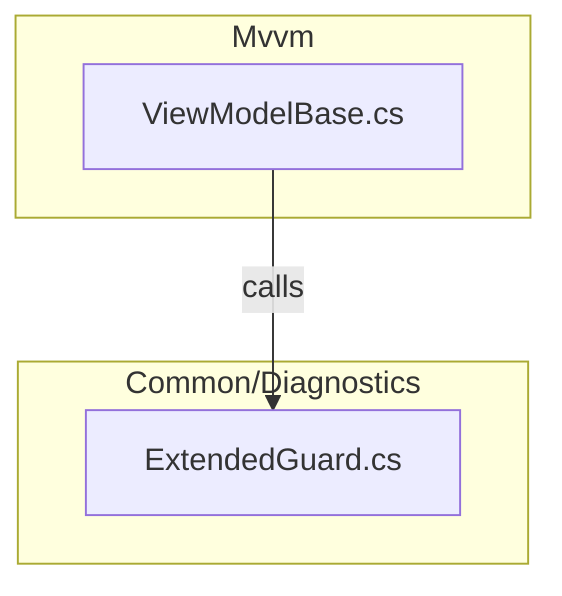

### Purpose

`Common/Diagnostics` is a utility folder within the `Common` project dedicated to argument validation helpers. It currently contains a single source file, `ExtendedGuard.cs`, which provides static methods for checking collection membership. The directory exists to centralize these specific preconditions so that view models can verify state changes without duplicating logic.

### Software Components

The only component here is `ExtendedGuard`, a static class defined in `ExtendedGuard.cs`. It offers two generic methods, [Contains](Common/Diagnostics/ExtendedGuard.md) and [NotContains](Common/Diagnostics/ExtendedGuard.md), which act as guards for adding or removing items from collections. These methods throw an `ArgumentException` if the membership condition is not met.

### Relationships

`ExtendedGuard` is a leaf dependency with no internal references. It is consumed solely by `Mvvm/ViewModelBase.cs`. Specifically, `ViewModelBase.RegisterChildViewModel` calls `NotContains` to prevent duplicate registrations, while `UnregisterChildViewModel` calls `Contains` to ensure a child exists before removal. The class complements the standard MVVM toolkit `Guard` by handling collection-specific logic that the standard library omits.

### Rough edges

The `name` parameter accepted by `ExtendedGuard` methods is not interpolated into the exception messages. Consequently, the thrown errors contain the literal string `{name}` rather than the specific argument name, which reduces diagnostic value.

## Contents
- [ExtendedGuard.cs](Common/Diagnostics/ExtendedGuard.md)