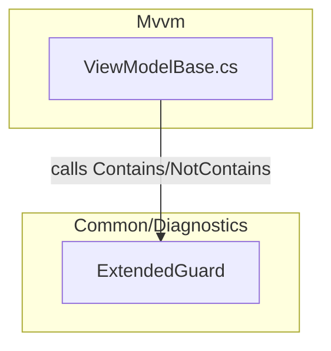

### Purpose

`Common/Diagnostics` contains a single static utility class, [ExtendedGuard](Common/Diagnostics/ExtendedGuard.md), that enforces argument preconditions for collection membership. It supplements the standard `Guard` library by providing `Contains` and `NotContains` assertions that throw `ArgumentException` if a collection unexpectedly does or does not contain a specific item. This ensures that add and remove operations in the View Model layer fail loudly rather than silently producing duplicates or no-ops.

### Software Components

The directory consists solely of `ExtendedGuard.cs`, which defines the `ExtendedGuard` class. This class provides two generic methods:
*   [Contains](Common/Diagnostics/ExtendedGuard.md): Asserts that an item exists in an `ICollection<T>`.
*   [NotContains](Common/Diagnostics/ExtendedGuard.md): Asserts that an item does not exist in an `ICollection<T>`.

Both methods accept the collection, the item to test, and a string name intended for error messages. The class has no dependencies on other project code, relying only on `System.Collections.Generic`.

### Relationships

`ExtendedGuard` is a leaf utility with no internal dependencies within the `Common` project. Its only consumer is `Mvvm/ViewModelBase.cs`. Specifically, `ViewModelBase.RegisterChildViewModel` calls `ExtendedGuard.NotContains` to prevent duplicate child View Models, while `ViewModelBase.UnregisterChildViewModel` calls `ExtendedGuard.Contains` to ensure a child is registered before removal. `ViewModelBase` uses both this custom guard and the standard MVVM toolkit `Guard` for null checks, treating `ExtendedGuard` as a specialized addition for collection logic.

### Rough edges

The `name` parameter in both methods is never used in the exception messages. The error strings hard-code the literal text `"'{name}'"` instead of interpolating the variable, meaning the thrown exception does not identify which specific argument failed, rendering the parameter dead code.

## Contents
- [ExtendedGuard.cs](Common/Diagnostics/ExtendedGuard.md)