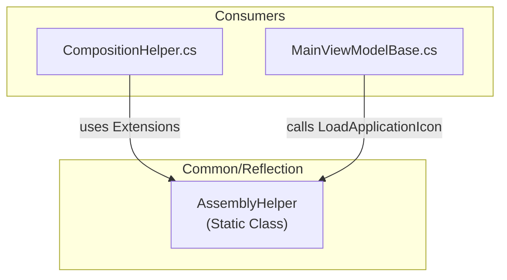

### Purpose

The `Common/Reflection` directory provides lightweight utilities for inspecting assembly metadata and file locations within the .NET ecosystem. It exists to centralize reflection-heavy logic that is otherwise verbose to write, ensuring that UI, logging, and composition layers can retrieve assembly details without duplicating `Attribute.GetCustomAttribute` boilerplate. This directory contains only source code, specifically the `AssemblyHelper` class.

### Software Components

The directory contains a single static class, `AssemblyHelper`, located in [AssemblyHelper.cs](Common/Reflection/AssemblyHelper.md). This class serves as the sole component here, offering stateless, pure-function utilities.

`AssemblyHelper` groups its methods into three distinct responsibilities:
*   **File System Utilities:** Methods like `GetAssemblyFileName` and `GetApplicationDirectory` resolve the physical location of executing or entry assemblies. The `Extensions` property lists valid assembly file types (`.dll`, `.exe`) for file discovery.
*   **Metadata Accessors:** A set of methods (`GetAssemblyCompany`, `GetAssemblyProduct`, etc.) extracts standard assembly attributes, returning empty strings if the attribute is missing to simplify caller logic.
*   **Application Resources:** `LoadApplicationIcon` specifically targets the entry assembly to retrieve an embedded application icon, designed for use by WPF main view models.

### Relationships

The dependency direction is strictly unidirectional: `AssemblyHelper` depends only on the .NET Framework (`System.Reflection`, `System.IO`, `System.Drawing`) and has no internal repository dependencies. However, it is a foundational utility for other parts of the codebase.

`Common/Composition/CompositionHelper.cs` relies on `AssemblyHelper.Extensions` to identify candidate assemblies for MEF composition. `Mvvm/MainViewModelBase.cs` calls `AssemblyHelper.LoadApplicationIcon` during construction to set the application window's icon. The metadata accessor methods currently have no in-repository callers but provide a general-purpose API for any module needing assembly identity details.

### Rough edges

`GetAssemblyFileName` assumes `assembly.Location` is a valid file URI, which fails for dynamic or in-memory assemblies where `Location` is empty. Additionally, `LoadApplicationIcon` returns an unmanaged `Icon` object that the known caller (`MainViewModelBase`) does not dispose, resulting in a minor resource leak per app launch.

## Contents
- [AssemblyHelper.cs](Common/Reflection/AssemblyHelper.md)