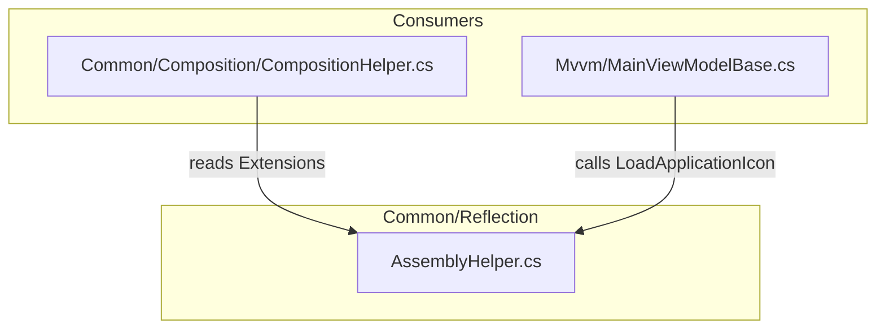

### Purpose

This directory contains a single static utility class, `AssemblyHelper`, designed to centralize reflection-based inspections of .NET assemblies. Its responsibility is to provide consistent access to assembly metadata (such as version, company, and culture) and file system details (like location and icon) without forcing callers to repeat `System.Reflection` boilerplate. The content belongs here because it groups these specific reflection helpers together, serving as a pure leaf dependency for other parts of the codebase that need to identify or describe loaded assemblies.

### Software Components

The directory consists of one source code file: [AssemblyHelper.cs](Common/Reflection/AssemblyHelper.md).

*   **`AssemblyHelper`**: A static class that acts as a facade for assembly inspection. It exposes a `Extensions` constant defining which file types (`.dll`, `.exe`) are considered valid assemblies, and a set of static methods to retrieve file paths, file extensions, and embedded attributes (company, product, copyright, etc.). It also includes `LoadApplicationIcon`, which extracts the application icon from embedded resources.

### Relationships

`AssemblyHelper` is a dependency sink; it imports only standard .NET libraries (`System.Reflection`, `System.IO`, `System.Drawing`) and does not reference other repository components. Consequently, it can be modified independently as long as its public API signature remains stable.

Two primary consumers depend on this class:
1.  **`Common/Composition/CompositionHelper.cs`** relies on the `Extensions` property to determine which files to scan when building its MEF composition catalog.
2.  **`Mvvm/MainViewModelBase.cs`** calls `LoadApplicationIcon` during initialization to set the WPF window icon.

If this class is removed or its behavior changed, the MEF bootstrap will fail to identify correct assembly files, and the main application window will lose its icon source. The attribute-reading methods (e.g., `GetAssemblyVersion`) have no visible internal callers but are part of the public API for external hosts.

## Contents
- [AssemblyHelper.cs](Common/Reflection/AssemblyHelper.md)