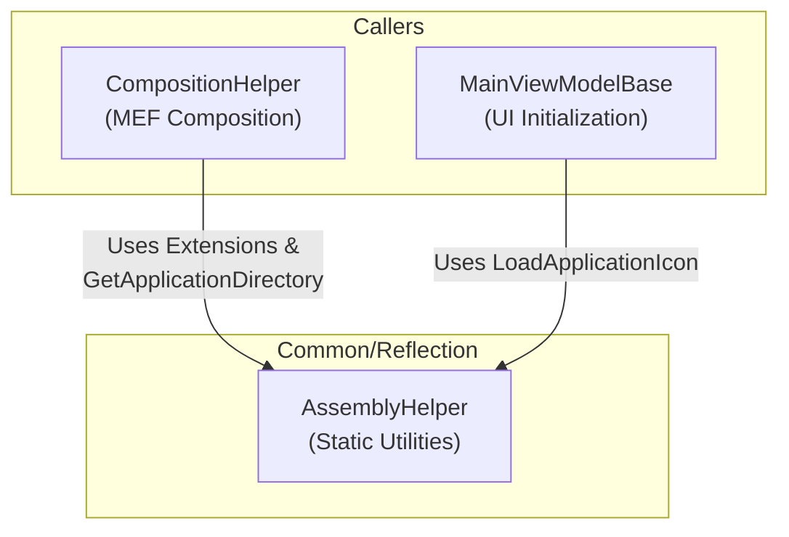

### Purpose

`Common/Reflection` provides static utilities for inspecting loaded assemblies, specifically to retrieve file paths, embedded icons, and standard assembly attributes like version and company. It exists to centralize `System.Reflection` boilerplate, preventing duplicate `Attribute.GetCustomAttribute` lookups and path parsing logic throughout the application.

### Software Components

The directory contains a single source file, `AssemblyHelper.cs`, which defines the static class `AssemblyHelper`. This class acts as a pure helper layer with no internal dependencies, relying only on framework namespaces like `System.Reflection`, `System.IO`, and `System.Drawing`.

The components within this class group into three distinct responsibilities:

*   **File Location Utilities:** Methods like `GetAssemblyFileName` and `GetApplicationDirectory` resolve the physical file system paths of assemblies. These are critical for assembly discovery scenarios.
*   **Metadata Accessors:** A set of methods such as `GetAssemblyCompany`, `GetAssemblyVersion`, and `GetAssemblyFileVersion` retrieve specific assembly attributes. They uniformly return `string.Empty` if an attribute is missing, simplifying error handling for callers.
*   **Icon Loading:** `LoadApplicationIcon` is unique in that it targets the entry assembly (rather than the executing assembly) to find and load an embedded `.ico` resource.

[AssemblyHelper](Common/Reflection/AssemblyHelper.md) is the sole component here. It does not load assemblies itself but operates on `Assembly` instances passed by the caller, except for the icon loader which fetches the entry assembly directly.

### Relationships

`AssemblyHelper` is consumed by two primary areas of the codebase:

1.  **`Common/Composition/CompositionHelper.cs`**: This is the main internal consumer. It uses `AssemblyHelper.Extensions` to filter files (`.dll`, `.exe`) when building a MEF `AggregateCatalog`. It also relies on `GetApplicationDirectory` to determine where to scan for these candidate assemblies.
2.  **`Mvvm/MainViewModelBase.cs`**: This class calls `LoadApplicationIcon()` in its constructor to set the WPF window icon.

The dependency direction is strict: callers depend on `AssemblyHelper`, but `AssemblyHelper` depends on nothing else in the application. It is a leaf node in the dependency graph.

### Rough edges

*   `GetAssemblyFileName` will throw a `UriFormatException` if called on an in-memory or dynamic assembly where `Assembly.Location` is empty.
*   The method `GetPublicKeyToken` is misleadingly named; it serializes the full public key, not the 16-byte token typically associated with strong-name strings.

## Contents
- [AssemblyHelper.cs](Common/Reflection/AssemblyHelper.md)