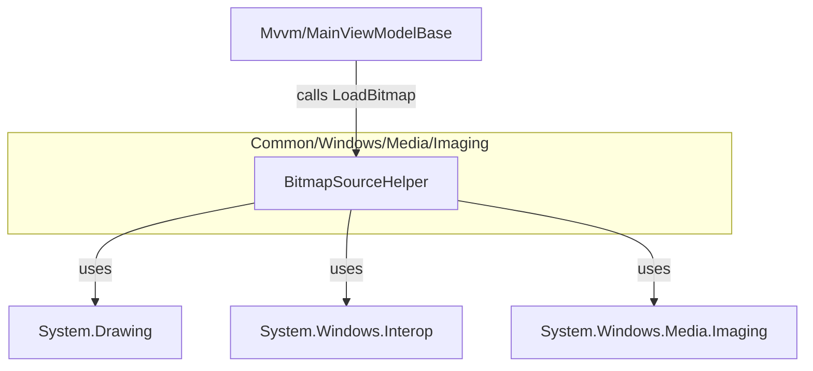

### Purpose

This directory provides a single static utility class, [BitmapSourceHelper](Common/Windows/Media/Imaging/BitmapSourceHelper.md), that bridges the imaging systems of GDI+ and WPF. It exists to handle the conversion between `System.Drawing.Bitmap` and WPF's `BitmapSource` types, which are not directly interoperable, and to load images from file paths into WPF-compatible formats. The directory contains only this one source file and serves as a leaf component within the `Common` project, with no internal dependencies on other custom code.

### Software Components

The directory contains one source code component:

*   **`BitmapSourceHelper`**: A static class in `BitmapSourceHelper.cs` that encapsulates all logic for crossing the GDI+/WPF imaging boundary. It provides methods for loading images from files or streams, converting GDI+ bitmaps to WPF `BitmapSource` objects, and converting WPF `BitmapSource` objects back to GDI+ bitmaps.

### Relationships

The component has no internal dependencies within the repository; it relies solely on .NET framework libraries (`System.Drawing`, `System.Windows.Interop`, `System.Windows.Media.Imaging`). Its only known caller within the codebase is `Mvvm/MainViewModelBase`, which invokes [BitmapSourceHelper](Common/Windows/Media/Imaging/BitmapSourceHelper.md) to convert the application icon into a `BitmapSource` for the window icon. Because this directory contains no other files or subdirectories, the relationship is strictly external: the caller depends on this module, but nothing within this module depends on other parts of the codebase.

### Rough edges

*   `LoadBitmap(Bitmap)` leaks a native GDI handle on every call because it does not release the HBITMAP obtained from `GetHbitmap()`. This is currently harmless as it is only used once at startup for the application icon, but would cause resource exhaustion if used in a loop.

## Contents
- [BitmapSourceHelper.cs](Common/Windows/Media/Imaging/BitmapSourceHelper.md)