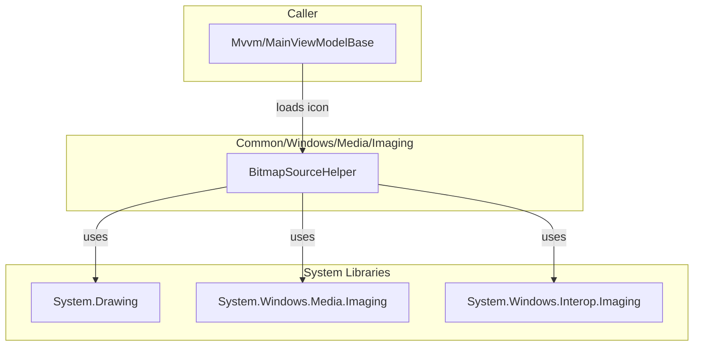

### Purpose

The `Common/Windows/Media/Imaging` directory serves as a bridge between GDI+ (`System.Drawing`) and WPF (`System.Windows.Media.Imaging`) image formats. It provides static utility methods to convert `Bitmap` objects to WPF `BitmapSource` instances and vice versa, allowing WPF UI elements to consume images generated by Win32 or GDI+ code without requiring callers to manage interop handles manually.

### Software Components

This directory contains a single source file: `BitmapSourceHelper.cs`. This file defines the `BitmapSourceHelper` class, a stateless static helper that encapsulates the plumbing for image format conversion.

The class exposes four primary entry points:
*   **`LoadImage`** and **`LoadBitmap(Bitmap)`**: Convert GDI+ images into WPF `BitmapSource` objects. The `LoadBitmap` method specifically uses `GetHbitmap` and `Imaging.CreateBitmapSourceFromHBitmap` to create the WPF object.
*   **`LoadBitmap(string)`** and **`LoadBitmap(Stream)`**: Load images directly from file paths or streams into WPF `BitmapSource` objects using `BitmapImage` with `CacheOption.OnLoad` to ensure the data is fully decoded and cached in memory.
*   **`SaveBitmap`**: Converts a WPF `BitmapSource` back into a GDI+ `Bitmap` by encoding the source to a BMP in a memory stream.

[BitmapSourceHelper.cs](Common/Windows/Media/Imaging/BitmapSourceHelper.md) is the only component here; it does not depend on other files in this directory but relies on standard .NET Framework/WPF libraries for the actual conversion logic.

### Relationships

`BitmapSourceHelper` acts as a leaf-level utility. It does not depend on other custom code within the repository, but it is consumed by higher-level components that need to display non-WPF native images in a WPF context.

For example, `Mvvm/MainViewModelBase` utilizes `BitmapSourceHelper.LoadBitmap` to load the application icon from an assembly resource and assign it to the window's `Icon` property. This pattern suggests that any module handling native icon resources or GDI+ generated thumbnails should route through this helper to avoid duplicating the `GetHbitmap`/`DeleteObject` interop logic.

The dependency flow is strictly one-way:
1.  Callers (e.g., ViewModels) request a conversion.
2.  `BitmapSourceHelper` performs the conversion using BCL APIs.
3.  The resulting WPF `BitmapSource` or GDI+ `Bitmap` is returned to the caller.

### Rough edges

`BitmapSourceHelper.LoadBitmap(Bitmap)` creates a GDI handle via `GetHbitmap` but does not call `DeleteObject` to release it, resulting in a native handle leak for every conversion. Additionally, `SaveBitmap` forces all output to BMP format via `BmpBitmapEncoder`, which may not be desirable if the caller expects a different image format for the returned `Bitmap`.

## Contents
- [BitmapSourceHelper.cs](Common/Windows/Media/Imaging/BitmapSourceHelper.md)