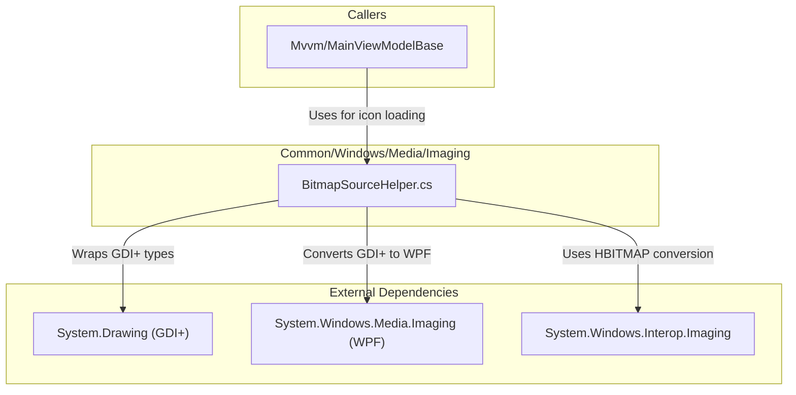

### Purpose

The `Common/Windows/Media/Imaging` directory serves as the bridge between GDI+ and WPF imaging systems. It provides the utility methods required to convert `System.Drawing.Bitmap` objects into WPF `BitmapSource` types, allowing UI elements to display images originally generated by Win32 or GDI+ APIs. This directory contains only one source file, `BitmapSourceHelper.cs`, which encapsulates all conversion logic.

### Software Components

The directory contains a single static utility class:

*   **[BitmapSourceHelper](Common/Windows/Media/Imaging/BitmapSourceHelper.md)**: This stateless class handles all image format conversions and file loading. It exposes static methods to load images from streams, files, or existing GDI+ bitmaps, and to save WPF bitmaps back to GDI+ format.

### Relationships

`BitmapSourceHelper` is a leaf-level component with no internal dependencies on other custom code. It relies exclusively on BCL and WPF imaging APIs. Specifically, it uses `System.Windows.Interop.Imaging.CreateBitmapSourceFromHBitmap` to perform the core conversion from GDI handles to WPF sources.

The primary caller is `Mvvm/MainViewModelBase`, which invokes [LoadBitmap(Bitmap)](Common/Windows/Media/Imaging/BitmapSourceHelper.md) during construction to set the application window icon. Because `BitmapSourceHelper` is the only file in this directory and has no child subdirectories, there are no internal relationships to diagram. The class acts as a standalone adapter between two native imaging stacks.

### Rough Edges

[LoadBitmap(Bitmap)](Common/Windows/Media/Imaging/BitmapSourceHelper.md) acquires a native GDI handle via `GetHbitmap()` but never releases it with `DeleteObject`. This results in a small, bounded memory leak for the specific use case of loading the window icon, but would cause handle exhaustion if the method were called repeatedly.

## Contents
- [BitmapSourceHelper.cs](Common/Windows/Media/Imaging/BitmapSourceHelper.md)