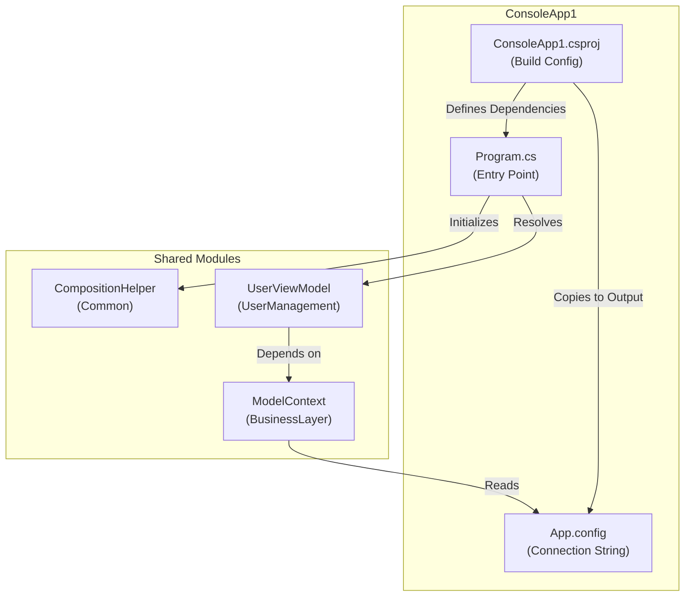

### Purpose

`ConsoleApp1` is a thin console host application that serves as the command-line entry point for the user management demo. It exists to exercise the shared `UserManagement` module and its underlying business logic without requiring a graphical interface. The contents—`Program.cs`, `App.config`, and `ConsoleApp1.csproj`—belong together because they form the minimal set of files required to compile and run this specific host variant within the larger solution.

### Software Components

The primary component is the `Program` class, defined in [Program.cs](ConsoleApp1/Program.md). Its `Main` method handles application startup, builds a MEF composition container, resolves the `IUserViewModel` export, and executes a fixed demo routine: saving a test user 100 times and printing the resulting user list.

The [App.config](ConsoleApp1/App.md) file provides the runtime configuration, specifically the `ConnectionString` for the SQL Server database. Although the console application itself does not read this file directly, it is essential for the `BusinessLayer` and `DataAccessLayer` components to initialize their Hibernate session factories.

The [ConsoleApp1.csproj](ConsoleApp1/ConsoleApp1.md) file defines the build configuration, targeting `net10.0-windows`. It references the `Common`, `Mvvm.Console`, and `UserManagement` projects, ensuring that the necessary assemblies are available for the MEF composition process at runtime.

### Relationships

The `Program` class in `Program.cs` acts as the bootstrap for the application. It relies on `Common/Composition/CompositionHelper` to scan the application directory and load assemblies into a `CompositionContainer`. This container then resolves the `UserViewModel` from the `UserManagement` project.

`App.config` supports the data access layer indirectly. When `ModelContext` is instantiated within the business layer, it reads the `ConnectionString` key from `App.config` to configure the database connection. Without this key, the application would fail during the composition or first database interaction.

The dependency flow is linear: `Program.cs` triggers the composition, which loads `UserManagement` and its dependencies (Business/Data layers). Those layers, in turn, depend on the configuration provided by `App.config`.

### Rough edges

`Program.cs` passes `"ConsoleApp1.exe"` to the composition helper to exclude it from the MEF scan. However, the actual assembly is typically built as `ConsoleApp1.dll`, so this exclusion string often matches nothing, potentially leading to unintended assembly loading behavior. Additionally, the demo logic contains a flaw where users are added to the list both during the save loop (via messenger events) and again during the final load, resulting in duplicate entries in the console output.

## Contents
- [App.config](ConsoleApp1/App.md)
- [ConsoleApp1.csproj](ConsoleApp1/ConsoleApp1.md)
- [Program.cs](ConsoleApp1/Program.md)