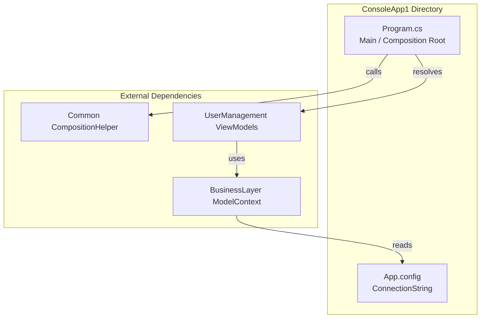

### Purpose

`ConsoleApp1` is a lightweight console host for the `UserManagement` feature, serving as a headless client to verify the system's MEF composition and data access flow. It contains no UI logic or custom business rules; its sole responsibility is to act as a composition root. The contents belong together because they form the minimal executable unit required to initialize the dependency container, resolve the feature’s view models, and execute a simple data workflow (creating and listing users) without a graphical interface.

### Software Components

The directory contains one primary source code component and one configuration file.

*   **Entry Point and Composition Root**: `Program.cs` defines the `Program` class and its `Main` method. This component handles the lifecycle of the application: it constructs the MEF composition container using `CompositionHelper`, resolves the `IUserViewModel` export, and drives the feature logic by invoking `AddUserViewModel.SaveUserAsync()` and `ShowUsersViewModel.OnLoadedAsync()`.
*   **Runtime Configuration**: `App.config` provides the `ConnectionString` app setting. Although `Program.cs` does not directly read configuration, this file is critical because downstream components (specifically `ModelContext` in the `BusinessLayer`) resolve the connection string from here via `System.Configuration` to connect to the SQL Server database.

### Relationships

The relationship in this directory is strictly unidirectional: the entry point initiates the composition process, and the configuration file supports the data layer resolved through that process.

`Program.cs` relies on `Common` and `UserManagement` assemblies (external to this directory but loaded via the composition container) to perform its work. It uses `CompositionHelper.CreateCompositionContainer` to build a catalog from the output directory. Once the container is ready, it resolves `IUserViewModel`. This resolution triggers the MEF composition of the entire user management graph, including `AddUserViewModel` and `ShowUsersViewModel`.

During the execution of these view models, the `BusinessLayer` (specifically `ModelContext`) reads the `ConnectionString` defined in `App.config`. Thus, `App.config` is a passive dependency that enables the active logic in `Program.cs` to persist data. There are no internal dependencies *between* files in this directory; `Program.cs` does not reference `App.config` directly, nor does `App.config` reference any code.

### Rough edges

*   The `App.config` connection string is hard-coded to `localhost` and `Integrated Security`, which fails silently or throws obscure errors if the local SQL Server instance is not running or the current user lacks permissions.
*   `Program.cs` contains a redundant null check (`if (userViewModel == null)`) that is unreachable because `SingleOrDefault()` already throws an exception if no matches are found.

## Contents
- [App.config](ConsoleApp1/App.md)
- [Program.cs](ConsoleApp1/Program.md)