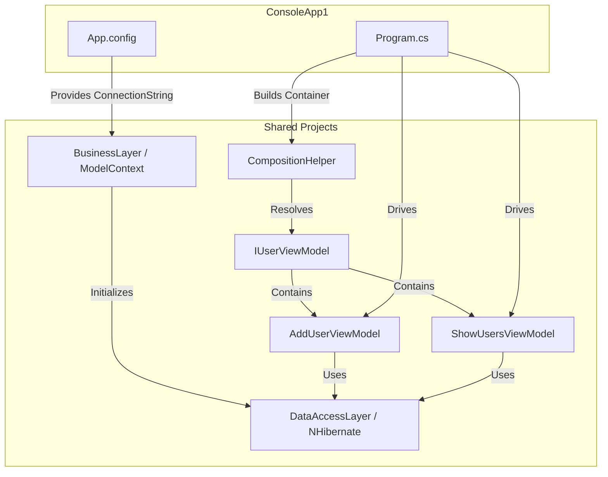

### Purpose

`ConsoleApp1` is a .NET console application that serves as the headless executable host for the solution. Its primary responsibility is to verify that the MEF (Managed Extensibility Framework) dependency injection container composes correctly without a UI, then execute a test workload by creating 100 users and displaying them. It belongs together as the simplest entry point in a multi-host solution, sharing the same business logic and data access layers as its WPF and WinForms siblings while removing all presentation dependencies.

### Software Components

The project consists of a single code component: the `Program` class.

*   **`Program`**: Defined in [Program.cs](ConsoleApp1/Program.md), this class contains the static `Main` method, which acts as the composition root. It is responsible for building the MEF container, resolving the root `UserViewModel`, driving the `AddUserViewModel` to create test data, and driving the `ShowUsersViewModel` to retrieve and print the results. It does not contain any business logic itself; it merely orchestrates the interaction with the shared `UserManagement` and `BusinessLayer` projects.

The project also includes [App.config](ConsoleApp1/App.md), which is a configuration file rather than a software component. It provides the `ConnectionString` required by the data access layer at runtime.

### Relationships

The dependency flow is strictly unidirectional: `Program.cs` initiates the process, consumes configuration from `App.config`, and drives the shared `UserManagement` view models.

1.  **Initialization**: `Program.Main` calls `CompositionHelper.CreateCompositionContainer` to build the MEF container. This container scans the assembly directory to discover parts.
2.  **Configuration**: The MEF composition process eventually instantiates `BusinessLayer/ModelContext`, which reads the `ConnectionString` from [App.config](ConsoleApp1/App.md). This connection string is then injected into the NHibernate session factory. Without this configuration, the application fails at runtime when attempting to access the database.
3.  **Execution**: Once the container is built, `Program.cs` resolves `IUserViewModel`. It then interacts with `AddUserViewModel` (via `SaveUserAsync`) and `ShowUsersViewModel` (via `OnLoadedAsync`). These view models, located in the `UserManagement` project, handle the actual logic of persisting and retrieving users through the `IUserService`.
4.  **Termination**: The `using` block in `Program.cs` ensures the MEF container is disposed after the work is complete.

### Rough edges

*   The call to `CreateCompositionContainer(["ConsoleApp1.exe"])` in [Program.cs](ConsoleApp1/Program.md) passes the executable name as an *ignore* list. Since the console app is the entry assembly, it is loaded regardless, making this parameter effectively redundant and potentially confusing to future readers who might expect it to define the primary module.
*   The test data generation in [Program.cs](ConsoleApp1/Program.md) creates 100 users with identical names ("Firstname Lastname"). This makes it impossible to verify per-iteration state changes in the output, limiting the utility of the console run as a detailed integration test.

## Contents
- [App.config](ConsoleApp1/App.md)
- [Program.cs](ConsoleApp1/Program.md)