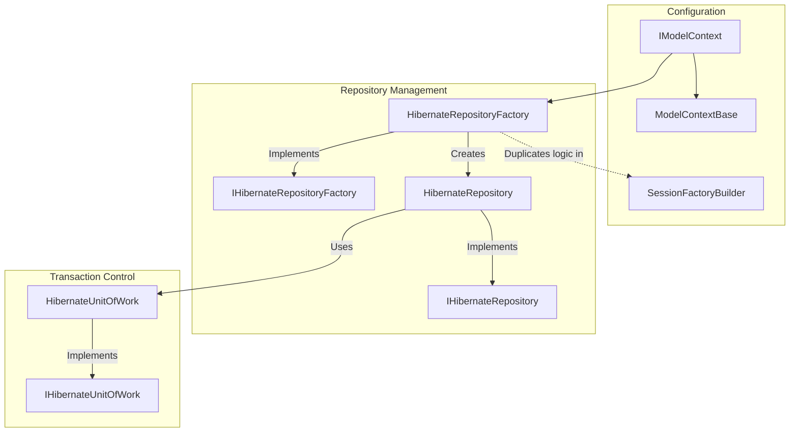

### Purpose

`DataAccessLayer.Hibernate` is the NHibernate implementation layer of the data access stack. It provides concrete classes and NHibernate-specific interfaces that allow the business layer to perform reads, inserts, and transaction management without directly referencing NHibernate types. The directory serves as a bridge, translating abstract repository and unit-of-work contracts from the `DataAccessLayer` project into concrete NHibernate operations using stateless sessions and Fluent NHibernate configurations.

### Software Components

The directory consists of three main functional groups: repository management, transaction control, and configuration bootstrapping.

The **repository management** group centers on [HibernateRepository.cs](DataAccessLayer.Hibernate/HibernateRepository.md), which implements `IHibernateRepository<TKey>` and uses a stateless session for queries and insert-only operations. [HibernateRepositoryFactory.cs](DataAccessLayer.Hibernate/HibernateRepositoryFactory.md) builds the `ISessionFactory` and creates repository instances. The interfaces [IHibernateRepository.cs](DataAccessLayer.Hibernate/IHibernateRepository.md) and [IHibernateRepositoryFactory.cs](DataAccessLayer.Hibernate/IHibernateRepositoryFactory.md) define the contracts, ensuring the business layer depends on abstractions rather than concrete NHibernate classes.

The **transaction control** group includes [HibernateUnitOfWork.cs](DataAccessLayer.Hibernate/HibernateUnitOfWork.md), which wraps session transactions to provide atomic commit and rollback capabilities. [IHibernateUnitOfWork.cs](DataAccessLayer.Hibernate/IHibernateUnitOfWork.md) extends the base unit of work contract to allow specifying isolation levels.

The **configuration bootstrapping** group contains [IModelContext.cs](DataAccessLayer.Hibernate/IModelContext.md) and [ModelContextBase.cs](DataAccessLayer.Hibernate/ModelContextBase.md). These abstract the supply of the connection string and mapping assemblies required to initialize NHibernate. Additionally, [SessionFactoryBuilder.cs](DataAccessLayer.Hibernate/SessionFactoryBuilder.md) contains a static helper for building the session factory, though it currently duplicates logic already present in the repository factory.

### Relationships

The dependency flow is strictly downward: the business layer depends on the interfaces defined here, and the concrete classes in this directory depend on NHibernate.

`HibernateRepositoryFactory<TKey>` is the entry point for configuration. It receives a connection string and mapping assemblies (typically via `IModelContext`), builds the `ISessionFactory`, and creates `HibernateRepository<TKey>` instances. Each repository instance owns a stateless session. When a caller requires transactional behavior, the repository lazily instantiates a `HibernateUnitOfWork` that shares that same session.

`SessionFactoryBuilder` is a parallel path that performs the same configuration steps as `HibernateRepositoryFactory` but is currently not part of the active wiring. This creates a maintenance risk where configuration changes must be applied in two places.

### Rough edges

- `SessionFactoryBuilder` duplicates the NHibernate configuration logic found in `HibernateRepositoryFactory`, creating a maintenance hazard where one copy may drift out of sync.
- `HibernateRepository.Save` is named generically but only performs inserts; there is no support for updates or upserts.
- `HibernateUnitOfWork` does not roll back or commit a live transaction upon disposal, potentially leaving transactions in an ambiguous state if the unit of work is disposed while a transaction is active.

## Contents
- [HibernateRepository.cs](DataAccessLayer.Hibernate/HibernateRepository.md)
- [HibernateRepositoryFactory.cs](DataAccessLayer.Hibernate/HibernateRepositoryFactory.md)
- [HibernateUnitOfWork.cs](DataAccessLayer.Hibernate/HibernateUnitOfWork.md)
- [IHibernateRepository.cs](DataAccessLayer.Hibernate/IHibernateRepository.md)
- [IHibernateRepositoryFactory.cs](DataAccessLayer.Hibernate/IHibernateRepositoryFactory.md)
- [IHibernateUnitOfWork.cs](DataAccessLayer.Hibernate/IHibernateUnitOfWork.md)
- [IModelContext.cs](DataAccessLayer.Hibernate/IModelContext.md)
- [ModelContextBase.cs](DataAccessLayer.Hibernate/ModelContextBase.md)
- [SessionFactoryBuilder.cs](DataAccessLayer.Hibernate/SessionFactoryBuilder.md)