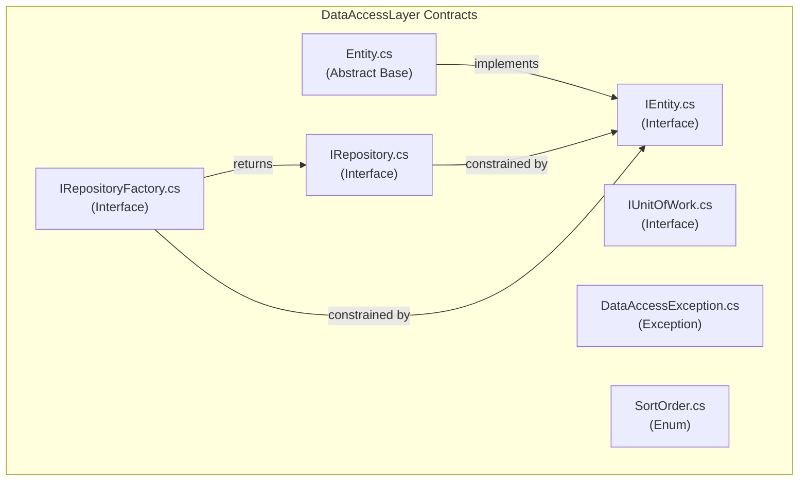

### Purpose

`DataAccessLayer` is the contract project for the data access layer, defining the abstractions that allow business logic to interact with the persistence engine without knowing which ORM is in use. It contains no implementation logic; its sole responsibility is to establish the interfaces, base types, and shared exception types that higher layers depend on.

The contents belong together because they form a closed set of dependencies required to define a repository pattern. You need the entity contract to define what can be stored, the repository interface to define how to retrieve it, the factory to define how to instantiate repositories, and the unit of work to define how to manage transactions. Keeping these in a separate project ensures that the `BusinessLayer` never directly references NHibernate or any other persistence library.

### Software Components

The code in this directory breaks down into four main functional groups, all defined as interfaces or base classes with minimal logic.

**Entity Contracts**
*   **`IEntity.cs`**: Defines [IEntity](DataAccessLayer/IEntity.md), the marker interface that any persistable object must implement. It enforces a read-only `Id` property of a struct type.
*   **`Entity.cs`**: Defines [Entity](DataAccessLayer/Entity.md), the abstract base class that implements [IEntity](DataAccessLayer/IEntity.md). It provides the default implementation for the `Id` property, ensuring concrete entities inherit the "identity is assigned by the provider" behavior.

**Repository Contracts**
*   **`IRepository.cs`**: Defines [IRepository](DataAccessLayer/IRepository.md), the primary read-only query contract. It exposes methods like `GetQueryable` and `Find`, allowing business code to query data via LINQ without touching the database driver.
*   **`IRepositoryFactory.cs`**: Defines [IRepositoryFactory](DataAccessLayer/IRepositoryFactory.md), the contract for creating and disposing repository instances. This isolates the session management logic from the business layer.

**Transaction & Support**
*   **`IUnitOfWork.cs`**: Defines [IUnitOfWork](DataAccessLayer/IUnitOfWork.md), the interface for managing database transactions (`Begin`, `Commit`, `Rollback`). This allows business services to treat multiple operations as an atomic unit.
*   **`DataAccessException.cs`**: Defines [DataAccessException](DataAccessLayer/DataAccessException.md), a custom exception type intended to wrap persistence errors. This allows callers to catch database failures without handling ORM-specific exceptions.
*   **`SortOrder.cs`**: Defines the [SortOrder](DataAccessLayer/SortOrder.md) enum for specifying ascending or descending sort directions.

### Relationships

The components in this directory form a dependency graph where the repository and factory contracts rely on the entity contracts to enforce type safety.

*   **Entity Constraint**: [IRepository](DataAccessLayer/IRepository.md) and [IRepositoryFactory](DataAccessLayer/IRepositoryFactory.md) both constrain their generic entity types to `IEntity<TKey>`. This ensures that only types with a valid, read-only identity can be passed to the repository methods.
*   **Factory Output**: [IRepositoryFactory](DataAccessLayer/IRepositoryFactory.md) produces repositories that implement [IRepository](DataAccessLayer/IRepository.md). In the broader codebase, the business layer interacts with the factory to get a repository instance, which it then uses to execute queries defined in [IRepository](DataAccessLayer/IRepository.md).
*   **Transaction Context**: While [IRepository](DataAccessLayer/IRepository.md) is stateless in this contract, concrete implementations (like `IHibernateRepository` in other projects) expose a `UnitOfWork` property. [IUnitOfWork](DataAccessLayer/IUnitOfWork.md) provides the transactional context for those operations.
*   **Error Boundary**: [DataAccessException](DataAccessLayer/DataAccessException.md) is designed to be thrown by the concrete implementations when persistence fails, allowing the `BusinessLayer` to catch a single, consistent exception type.

Note that [SortOrder](DataAccessLayer/SortOrder.md) is currently isolated. It is not referenced by any other interface in this directory or in the known concrete implementations, meaning it is available for future use but not part of the active query contract.

### Rough edges

*   **Unimplemented Cleanup**: The `Drop()` method in [IRepositoryFactory](DataAccessLayer/IRepositoryFactory.md) is part of the contract, but the known concrete implementation throws `NotImplementedException`. Code relying on this for graceful shutdown will crash.
*   **Narrow Exception Coverage**: [DataAccessException](DataAccessLayer/DataAccessException.md) is only thrown during factory initialization in the current codebase. It does not wrap standard query or transaction failures, so catching it will not capture all runtime data access errors.
*   **Unused Enum**: [SortOrder](DataAccessLayer/SortOrder.md) is defined but not utilized by any interface in this directory. It appears to be reserved for future functionality or unused by the current query APIs.

## Contents
- [DataAccessException.cs](DataAccessLayer/DataAccessException.md)
- [Entity.cs](DataAccessLayer/Entity.md)
- [IEntity.cs](DataAccessLayer/IEntity.md)
- [IRepository.cs](DataAccessLayer/IRepository.md)
- [IRepositoryFactory.cs](DataAccessLayer/IRepositoryFactory.md)
- [IUnitOfWork.cs](DataAccessLayer/IUnitOfWork.md)
- [SortOrder.cs](DataAccessLayer/SortOrder.md)