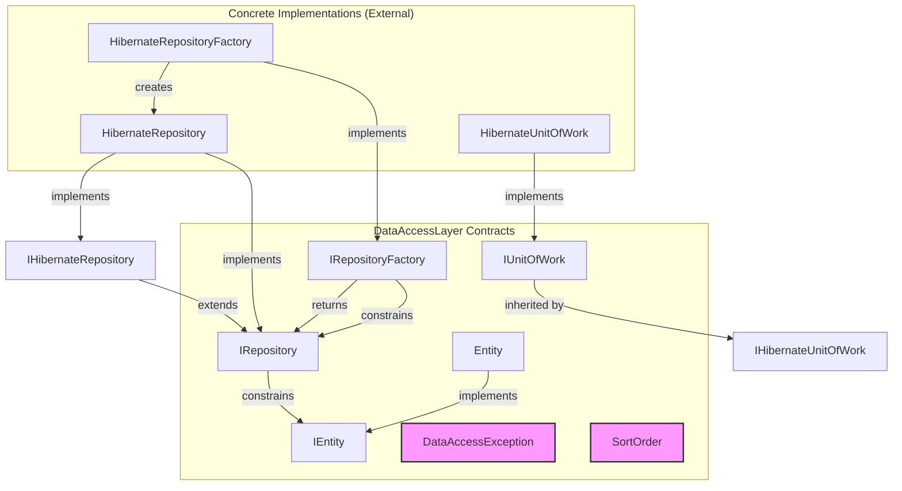

### Purpose

`DataAccessLayer` is a contracts-only project that defines the persistence abstractions for the application, containing interfaces and base classes with no executable logic. It establishes the standard for how the business layer interacts with the database, defining the entity marker, query contracts, factory patterns, and transaction units without referencing specific ORM technologies like NHibernate. These files belong together because they form the "engine-agnostic" boundary; by separating these definitions from their concrete implementations (which reside in `DataAccessLayer.Hibernate`), the project ensures that higher-level business logic depends only on these stable contracts.

### Software Components

The directory contains four distinct logical components:

*   **Entity Contract**: `IEntity.cs` and `Entity.cs` define the shape of persistable data. `IEntity<TKey>` is a marker interface requiring a value-type `Id`, while `Entity<TKey>` is the abstract base class that provides a default implementation for this identity.
*   **Query Contract**: `IRepository.cs` defines the read-only surface for data access. It specifies generic methods for querying entities using LINQ, allowing callers to filter data without knowing the underlying storage mechanism.
*   **Lifecycle Contract**: `IRepositoryFactory.cs` and `IUnitOfWork.cs` manage the creation and atomicity of data operations. The factory contract defines how repositories are instantiated and disposed, while the unit of work contract defines how transactions are begun, committed, or rolled back.
*   **Error & Utility Types**: `DataAccessException.cs` provides a specific exception type for wrapping persistence failures, and `SortOrder.cs` defines a simple enum for specifying sort direction.

### Relationships

The components in this directory form a dependency chain that flows from concrete implementations in other projects back to these abstract definitions. `IRepository<TKey>` is the central query interface, and `IRepositoryFactory<TRepository, TKey>` constrains the repositories it produces to implement this contract. Similarly, `IUnitOfWork` serves as the base for transaction management, which is exposed via repositories.

`Entity<TKey>` implements `IEntity<TKey>`, providing the concrete base for domain models like `User`. Both of these are consumed by `IRepository<TKey>`, whose methods enforce that the generic entity type must implement `IEntity<TKey>`. This constraint ensures that only types with a valid identity can be queried through the layer.

Note that `DataAccessException` and `SortOrder` are currently standalone utility types. `DataAccessException` is intended to be thrown by the data access layer to abstract away specific ORM errors, and `SortOrder` is available for future use in query methods, though neither is currently actively referenced by the other core components in this directory.

### Rough edges

*   `SortOrder` is defined but currently unused by any other component in the repository.
*   The `Drop()` method on `IRepositoryFactory` is part of the contract, but its primary implementation in the Hibernate layer throws `NotImplementedException`, meaning factory teardown is not fully functional.

## Contents
- [DataAccessException.cs](DataAccessLayer/DataAccessException.md)
- [Entity.cs](DataAccessLayer/Entity.md)
- [IEntity.cs](DataAccessLayer/IEntity.md)
- [IRepository.cs](DataAccessLayer/IRepository.md)
- [IRepositoryFactory.cs](DataAccessLayer/IRepositoryFactory.md)
- [IUnitOfWork.cs](DataAccessLayer/IUnitOfWork.md)
- [SortOrder.cs](DataAccessLayer/SortOrder.md)