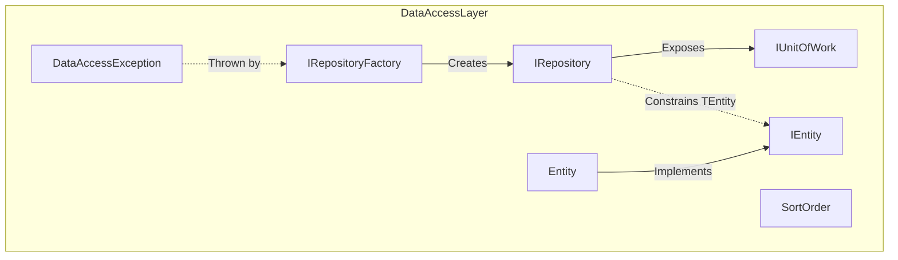

### Purpose

The `DataAccessLayer` project defines the abstract contracts for data persistence in this codebase. It provides the core interfaces for querying, managing transactions, and defining entity identities, allowing the application to remain decoupled from specific Object-Relational Mapping (ORM) providers.

These files belong together because they form a dependency-free foundation: they contain no logic, only definitions. By keeping the abstraction layer separate from implementation details (like NHibernate, which lives in `DataAccessLayer.Hibernate`), higher-level business logic can depend on these stable contracts without needing to know how the data is actually stored or retrieved.

### Software Components

This directory contains four distinct functional areas, all defined as interfaces or base types to enforce loose coupling:

**Entity Identity**
This group defines what counts as a "entity" for the persistence layer.
*   [IEntity](DataAccessLayer/IEntity.md) (`IEntity.cs`): The marker interface requiring a read-only `Id` of type `TKey`.
*   [Entity](DataAccessLayer/Entity.md) (`Entity.cs`): The abstract base class that implements `IEntity`, providing a standard `Id` property that concrete domain models (like `User`) inherit from.

**Querying**
This group defines how data is retrieved.
*   [IRepository](DataAccessLayer/IRepository.md) (`IRepository.cs`): The primary read-only contract. It exposes methods for finding single entities (`FindOne`, `Single`) and collections (`Find`, `GetAll`), as well as `IQueryable` access for composed LINQ queries. It is strictly query-oriented; it does not include save or delete operations.

**Factory & Lifecycle**
This group defines how repositories are instantiated.
*   [IRepositoryFactory](DataAccessLayer/IRepositoryFactory.md) (`IRepositoryFactory.cs`): The contract for creating and dropping repository instances. It abstracts the creation of stateless sessions, ensuring that each repository instance is independent.

**Transactions & Errors**
This group defines operational control and failure signaling.
*   [IUnitOfWork](DataAccessLayer/IUnitOfWork.md) (`IUnitOfWork.cs`): The contract for managing transactional boundaries (`Begin`, `Commit`, `Rollback`). It ensures that business operations can be treated as atomic units regardless of the underlying provider.
*   [DataAccessException](DataAccessLayer/DataAccessException.md) (`DataAccessException.cs`): A wrapper exception type that standardizes how persistence errors are propagated to consumers, hiding the underlying ORM/driver specifics.
*   [SortOrder](DataAccessLayer/SortOrder.md) (`SortOrder.cs`): A simple enum (`Ascending`/`Descending`) intended as a shared vocabulary for sorting, though it is currently unused by the other interfaces in this directory.

### Relationships

The components in this directory form a strict dependency hierarchy where the factory produces repositories, repositories expose the unit of work, and all entities conform to the entity contract.

`IRepositoryFactory` is the entry point for consumers. It creates instances of `IRepository` (specifically `IHibernateRepository` in the concrete layer). Once a repository is created, it exposes an `IUnitOfWork` instance, which the caller uses to wrap database operations in a transaction. All query methods in `IRepository` and the identity checks in `IEntity` rely on the `TKey` generic parameter being a `struct`, ensuring consistent key handling across the layer.

`DataAccessException` acts as the unified error boundary. While defined here, it is typically thrown by the concrete Hibernate implementations to wrap lower-level driver errors, allowing business layers to catch a single type for all persistence failures.

*Note: `SortOrder` is currently isolated from the other components in this directory as no interface currently accepts it as a parameter.*

### Rough edges

*   `IRepositoryFactory` includes a `Drop()` method that has no working implementation in the concrete layers, making it effectively unusable for shutdown logic.
*   `SortOrder` is defined but not referenced by any other interface or class in this directory, leaving its intended usage ambiguous.

## Contents
- [DataAccessException.cs](DataAccessLayer/DataAccessException.md)
- [DataAccessLayer.csproj](DataAccessLayer/DataAccessLayer.md)
- [Entity.cs](DataAccessLayer/Entity.md)
- [IEntity.cs](DataAccessLayer/IEntity.md)
- [IRepository.cs](DataAccessLayer/IRepository.md)
- [IRepositoryFactory.cs](DataAccessLayer/IRepositoryFactory.md)
- [IUnitOfWork.cs](DataAccessLayer/IUnitOfWork.md)
- [SortOrder.cs](DataAccessLayer/SortOrder.md)