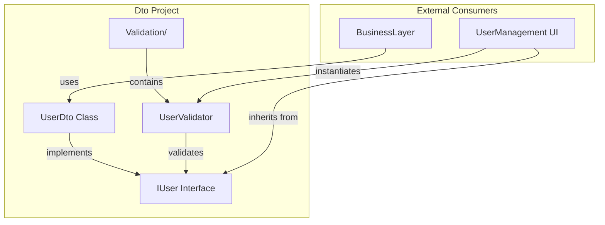

### Purpose

The `Dto` project serves as the shared data contract layer between the `UserManagement` UI and the `BusinessLayer`. It defines the minimal shape of user data required for communication across these boundaries, ensuring neither side depends directly on the NHibernate-persisted entity. The contents belong together because they establish the specific data structures (`IUser`, `UserDto`) and validation rules (`Validation/`) that define what constitutes valid user data, independent of UI or persistence logic.

### Software Components

This directory contains source code that forms a small, layered data model. The components are grouped by their role in data definition and validation:

- **Data Contracts**: Defined in the root files. [`IUser`](Dto/IUser.md) is the abstract interface declaring `FirstName` and `LastName`. It serves as the base type for UI-side view models and validation logic. [`UserDto`](Dto/UserDto.md) is the concrete implementation of [`IUser`](Dto/IUser.md) that adds the `Id` property. This class is the primary object exchanged with the business layer.
- **Validation Rules**: Located in [`Validation/`](Dto/Validation.md). This subdirectory contains [`UserValidator`](Dto/Validation/UserValidator.md), a FluentValidation validator that enforces non-empty name requirements against the [`IUser`](Dto/IUser.md) interface.

### Relationships

The dependency direction flows from concrete to abstract within the `Dto` project, and from the UI layer into `Dto`. [`UserDto`](Dto/UserDto.md) implements [`IUser`](Dto/IUser.md), creating a superset relationship where [`UserDto`](Dto/UserDto.md) includes the persistence `Id` while [`IUser`](Dto/IUser.md) remains a pure name contract.

The [`Validation/`](Dto/Validation.md) subdirectory depends on [`IUser`](Dto/IUser.md) but not on [`UserDto`](Dto/UserDto.md). [`UserValidator`](Dto/Validation/UserValidator.md) targets the interface, allowing it to validate any object exposing `FirstName` and `LastName`, such as the UI's `AddUserViewModel`. Externally, the `BusinessLayer` uses [`UserDto`](Dto/UserDto.md) for data transfer, while the `UserManagement` UI uses both [`IUser`](Dto/IUser.md) (for view model inheritance) and [`UserValidator`](Dto/Validation/UserValidator.md) (for input checking).

### Rough edges

The [`UserValidator`](Dto/Validation/UserValidator.md) in [`Validation/`](Dto/Validation.md) uses a `NotEmpty()` rule which technically allows whitespace-only strings, despite test expectations suggesting these should be rejected. This indicates a potential mismatch between the validation implementation and the intended business logic for clean input.

## Contents
- [IUser.cs](Dto/IUser.md)
- [UserDto.cs](Dto/UserDto.md)
- [Validation/](Dto/Validation.md)