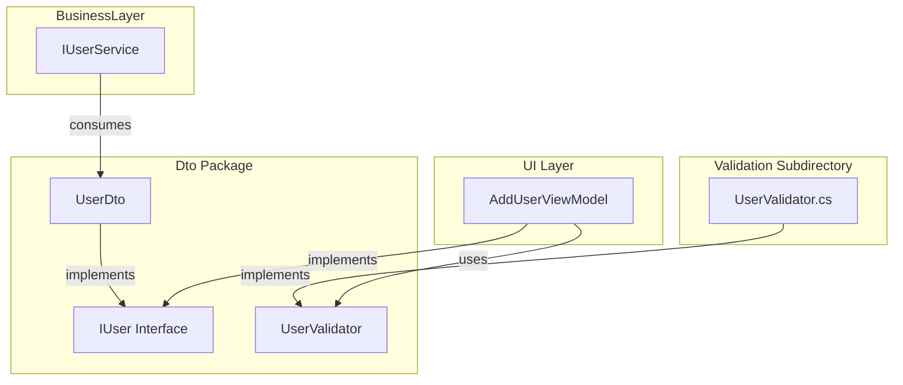

### Purpose

The `Dto` package defines the shared data contracts and validation rules for user information across the application. It acts as the neutral middle ground between the UI and business layers, ensuring that the presentation and service tiers exchange user data without depending directly on the persistence layer's entities. The contents are grouped together because the data types (like `UserDto`) and their validation logic (`Validation/`) are tightly coupled and consumed jointly by the higher-level features.

### Software Components

This package consists of two main components:

*   **Data Models**: Found in the root of the directory, this includes [UserDto](Dto/UserDto.md), a plain data object that carries user details like `FirstName`, `LastName`, and `Id`. It is backed by the [IUser](Dto/IUser.md) interface, which defines the minimal contract for user names. This interface allows the UI layer to bind to user data before an identity (`Id`) exists, while `UserDto` is the concrete object passed to the business layer.
*   **Validation Rules**: Located in the [Validation](Dto/Validation.md) subdirectory, this component contains `UserValidator`, a FluentValidation rule set. It ensures that `FirstName` and `LastName` are non-empty. This validator is designed to be injected into ViewModels, allowing the UI to enforce business rules on input before the data is ever sent to the service layer.

The package is built as a class library via [Dto.csproj](Dto/Dto.md), which targets .NET 10 and references the `FluentValidation` library. It has no project references of its own, making it a foundational dependency at the bottom of the solution's graph.

### Relationships

The `Dto` package is referenced only by the `BusinessLayer` project. Within the solution, the flow of data generally starts in the UI, where ViewModels implement `IUser` and use `UserValidator` to check input. Once valid, the UI constructs a `UserDto` and passes it to `IUserService` in the `BusinessLayer`. The `BusinessLayer` then maps this `UserDto` to its internal `User` entity for persistence.

### Rough edges

`UserDto` implements `IUser`, but `IUser` does not include the `Id` property. Consequently, any code that accepts `IUser` cannot access the user's ID without casting back to `UserDto`, which breaks the abstraction slightly and requires careful handling in the UI or business layers if identity is needed.

## Contents
- [Dto.csproj](Dto/Dto.md)
- [IUser.cs](Dto/IUser.md)
- [UserDto.cs](Dto/UserDto.md)
- [Validation/](Dto/Validation.md)