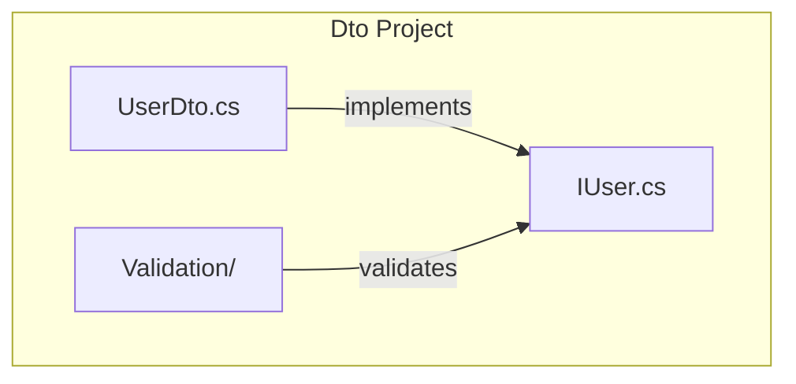

### Purpose

The `Dto` directory is a C# project that serves as the neutral data layer for the application. It defines the shared contracts and validation rules for user data, allowing the UI and business logic layers to communicate without depending on each other or the persistence entities. Its contents belong together because they form a single, self-contained module for defining "what a user looks like" to the rest of the system, stripped of any infrastructure concerns.

### Software Components

The directory contains two primary code components that work in tandem:

*   **`UserDto`**: Defined in `UserDto.cs`, this is the concrete data transfer object. It implements the `IUser` interface but adds an `Id` property to carry the persistence identifier across the service boundary. It contains no logic, only auto-properties, and acts as the payload for `IUserService` methods.
*   **`IUser`**: Defined in `IUser.cs`, this interface represents the minimal "user shape" consisting only of `FirstName` and `LastName`. It is the contract used by the validation layer and the view models in the UI. By omitting `Id`, it forces the UI to work with a simplified view of the user that does not require knowledge of the database identity.

These components are supported by the `Validation/` subdirectory, which houses the `UserValidator` class. This class applies FluentValidation rules to the `IUser` contract, ensuring that names are not empty before the data is processed further in the UI layer.

### Relationships

The dependency structure within `Dto` is strictly unidirectional from the concrete to the abstract. `UserDto` implements `IUser`, meaning any `IUser` reference can hold a `UserDto`, but not vice versa. This creates a deliberate asymmetry: the business layer (`IUserService`) uses `UserDto` to handle both reading (which needs `Id`) and writing (which needs names), while the UI layer (`AddUserViewModel`) interacts with `IUser` through its view model base, relying on `Validation/` for input checks.

This split means that a user object is effectively reshaped at the layer boundary. The UI creates an `IUser` via the view model, the service layer converts it to/from `UserDto` to manage the `Id`, and the validation rules apply only to the `IUser` shape. Consequently, changing the `IUser` contract impacts both the UI and the validation logic, while changing `UserDto` primarily affects the service layer and how it maps to the database entities.

## Contents
- [IUser.cs](Dto/IUser.md)
- [UserDto.cs](Dto/UserDto.md)
- [Validation/](Dto/Validation.md)