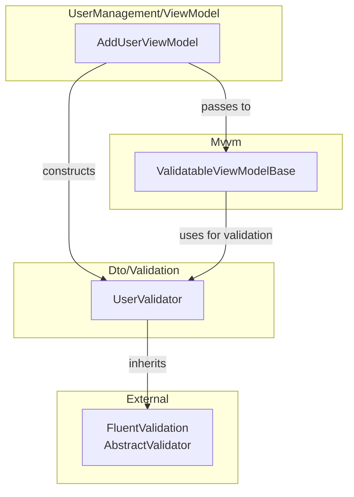

### Purpose

The `Dto/Validation` directory contains shared validation logic for Data Transfer Objects (DTOs). Its single responsibility is to provide reusable rule sets that UI ViewModels use to validate user input against business rules, rather than each ViewModel hand-rolling its own checks. The contents are grouped here because they rely on the type definitions in `Dto/` and serve the validation needs of the `Mvvm/` layer.

### Software Components

This directory consists of a single validation component:

*   **`UserValidator.cs`**: Contains the `UserValidator` class. This is a FluentValidation validator for the `IUser` interface. It enforces the specific business rule that both `FirstName` and `LastName` must be non-empty. It acts as a leaf component with no state or side effects, designed to be injected into ViewModels.

### Relationships

`UserValidator` sits at the boundary between the data model and the presentation logic. It extends `AbstractValidator<T>` from the external FluentValidation library, which provides the mechanism for rule execution.

The dependency flows from the UI layer to this directory. Specifically, `AddUserViewModel` (located in `UserManagement/ViewModel/`) constructs a new instance of [UserValidator](Dto/Validation/UserValidator.md) and passes it to its base class, `ValidatableViewModelBase<T>`. The base class then uses the `IValidator<T>` interface to run validation against the ViewModel's observable properties. Although `UserValidator` is written to validate `IUser`, in practice it validates the ViewModel itself because the ViewModel implements `IUser`. This allows the same validation rules to apply to both the transient UI state and the persisted data structure.

## Contents
- [UserValidator.cs](Dto/Validation/UserValidator.md)