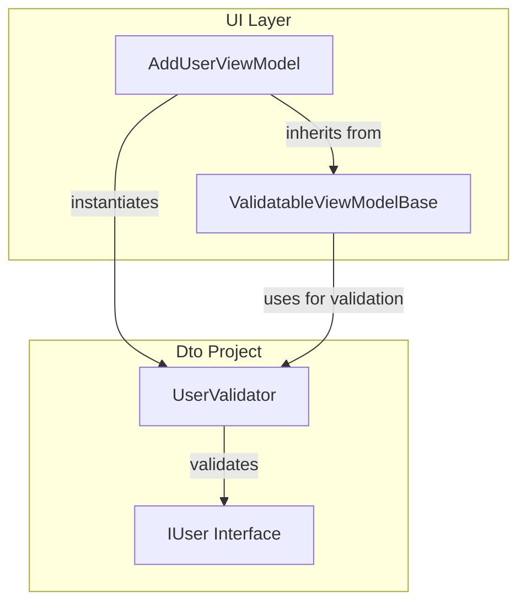

### Purpose

The `Dto/Validation` directory contains the application's core data validation rules. Its primary responsibility is to ensure that user data objects conform to business requirements, such as having non-empty names, before they are processed by the UI layer. The contents belong together because they isolate validation logic from the user interface, allowing the `Dto` project to define the "shape" of valid data independently of any specific view model or UI framework.

### Software Components

This directory consists of a single source code component:

*   `UserValidator.cs`: This file defines the [UserValidator](Dto/Validation/UserValidator.md) class. It is a stateless rule-set that inherits from FluentValidation’s `AbstractValidator<IUser>`. It enforces that both `FirstName` and `LastName` on any `IUser` object are non-empty. This is the only validator in the codebase, acting as a leaf node that UI components consume to trigger validation checks.

### Relationships

The dependency direction flows strictly from the UI layer into this directory. `UserValidator` depends on the `IUser` interface (defined in `Dto/IUser.cs`) to know what properties it must check. It does not depend on any other files within the `Dto` project.

When `AddUserViewModel` (in `UserManagement/ViewModel`) needs to verify user input, it instantiates `UserValidator` and injects it into `ValidatableViewModelBase<IUser>`. The base view model then calls the validator’s methods to surface errors to the UI via `INotifyDataErrorInfo`. Because the validator targets the `IUser` interface rather than a concrete class, any implementation of `IUser` is validated identically.

### Rough edges

The validation rule uses `NotEmpty()`, which allows whitespace-only strings, yet the associated test suite expects whitespace-only names to be rejected. This mismatch suggests either a missing `Trim()` rule or a test that is out of sync with the current implementation.

## Contents
- [UserValidator.cs](Dto/Validation/UserValidator.md)