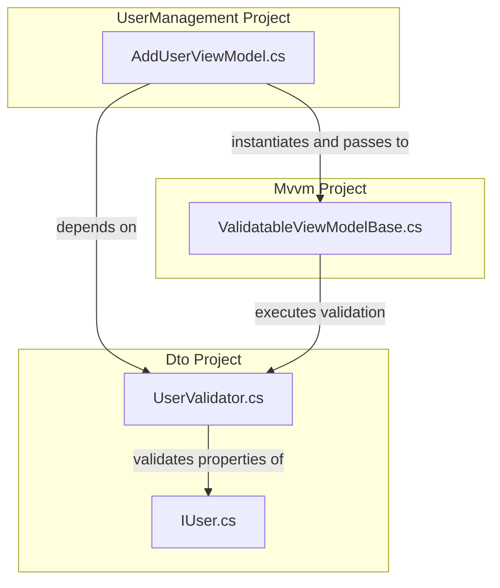

### Purpose

The `Dto/Validation` directory contains the application’s business logic for data validation, specifically using the FluentValidation library. Its sole responsibility is to enforce consistency rules on user data before it is processed further. It houses `UserValidator.cs`, which defines the constraints for the `IUser` contract, allowing the presentation layer to validate input automatically without duplicating manual checks.

### Software Components

This directory contains a single component: the [UserValidator](Dto/Validation/UserValidator.md) class located in `UserValidator.cs`.

[UserValidator](Dto/Validation/UserValidator.md) extends the external `AbstractValidator<T>` base class from FluentValidation. It encapsulates the specific rules that `FirstName` and `LastName` must be non-empty. By centralizing these rules here, the class ensures that any view model handling user data, such as `AddUserViewModel`, inherits this validation logic through the `ValidatableViewModelBase<T>` plumbing.

### Relationships

The directory acts as the validation boundary between the data model and the UI. `UserValidator.cs` defines the rules, while the `Mvvm` project’s `ValidatableViewModelBase` consumes them to trigger validation and surface error messages in the interface.

`UserValidator.cs` depends on `IUser` (defined in `Dto/IUser.cs`) to target the properties it validates. It does not depend on the UI layer, but the UI layer depends on it: `AddUserViewModel` passes an instance of [UserValidator](Dto/Validation/UserValidator.md) to its base class, which then runs the validation checks. This dependency flows strictly from the presentation layer down to this directory; changing rules here impacts the UI, but changes in the UI do not affect the validator.

## Contents
- [UserValidator.cs](Dto/Validation/UserValidator.md)