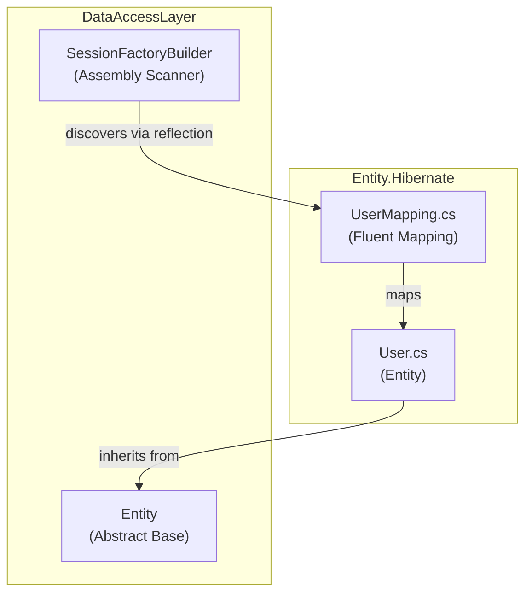

### Purpose

`Entity.Hibernate` is a .NET class library that defines the domain model for user persistence using NHibernate. It contains the `User` entity and its corresponding Fluent NHibernate mapping, allowing the rest of the application to save and retrieve user data without dealing with raw SQL or ORM configuration directly. The two files here belong together because they form a single unit of persistence: one defines the object shape, and the other defines how that shape maps to the database.

### Software Components

This directory consists of two main components that work in tandem:

*   **The Entity:** [User.cs](Entity.Hibernate/User.md) defines the `User` class. It inherits from the abstract `Entity<int>` base class provided by the `DataAccessLayer` project, which supplies the `Id` property. The `User` class holds `FirstName`, `LastName`, and an `IsActive` flag. All properties are marked `virtual` to support NHibernate’s lazy loading and proxying mechanisms.
*   **The Mapping:** [UserMapping.cs](Entity.Hibernate/UserMapping.md) defines the persistence rules for `User`. It is a Fluent NHibernate `ClassMap<User>` that specifies the table name (`Users`), primary key generation strategy (identity), and column constraints (such as `Not.Nullable` and length limits). It contains no executable logic itself; it serves as configuration consumed by the ORM during session factory initialization.

### Relationships

The dependency direction flows strictly from the mapping to the entity, and both are discovered by the data access layer at runtime.

1.  **Mapping depends on Entity:** [UserMapping.cs](Entity.Hibernate/UserMapping.md) uses lambda expressions (e.g., `x => x.FirstName`) that compile directly against the members of [User.cs](Entity.Hibernate/User.md). If you rename a property in `User`, the mapping will break at compile time.
2.  **External Consumption:** Neither file is called directly by business logic. Instead, `SessionFactoryBuilder` in the `DataAccessLayer` project scans the `Entity.Hibernate` assembly for classes inheriting from `ClassMap<T>`. This reflection-based discovery means the mapping is automatically picked up as long as it exists in the assembly.
3.  **Business Layer Interaction:** `UserService` in the `BusinessLayer` project is the only component that instantiates `User`. It creates new instances via the public constructor (which sets `IsActive` to `true`) and reads existing instances via NHibernate queries. The business layer never touches `UserMapping` directly.

### Rough edges

*   The `GetActiveUsers()` method in the business layer does not actually filter by `IsActive`, making the `IsActive` property effectively write-on-creation with no current consumer for its value.
*   The `User` constructor used by NHibernate for hydration explicitly assigns `null!` to `FirstName` and `LastName`, which is redundant since NHibernate overwrites these properties immediately after instantiation.

## Contents
- [User.cs](Entity.Hibernate/User.md)
- [UserMapping.cs](Entity.Hibernate/UserMapping.md)