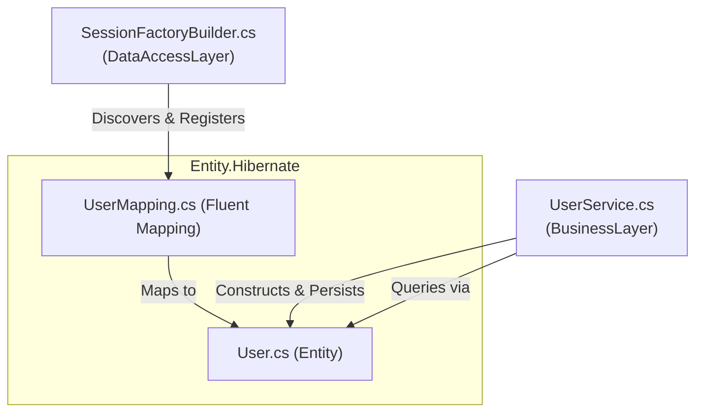

### Purpose

The `Entity.Hibernate` directory serves as the persistence model layer for the `User` domain object, containing the sole entity class and its corresponding Fluent NHibernate mapping. These files belong together because they define the contract between the application's in-memory representation of a user and the `Users` table in the database. Without this specific pairing, the ORM cannot translate domain objects into SQL queries or vice versa.

### Software Components

The directory contains two core source code files that work as a unit:

*   **`User.cs`**: Defines the `User` entity class. It inherits from `Entity<int>` and exposes `FirstName`, `LastName`, and `IsActive` properties. This class contains no business logic, only state and the constructor required for the ORM to instantiate it.
*   **`UserMapping.cs`**: Defines the Fluent NHibernate mapping for the `User` entity. It explicitly binds the `User` properties to the `Users` table, specifies that the `Id` is identity-generated, and enforces `NOT NULL` constraints on the name and active status columns.

### Relationships

The relationship between these two files is one of direct dependency and synchronization. `UserMapping.cs` is a `ClassMap<User>`; it directly references the `User` class from `User.cs` to bind properties. Consequently, renaming a property in `User.cs` will cause a compile-time error in `UserMapping.cs` if the mapping is not updated simultaneously.

Externally, these files are discovered indirectly by `DataAccessLayer.Hibernate/SessionFactoryBuilder.cs`. This builder uses reflection to find `UserMapping.cs` and register it with NHibernate. It also triggers a schema update, meaning the column definitions in `UserMapping.cs` directly drive the database schema creation. The `User` entity is only instantiated by `BusinessLayer/UserService.cs`, which relies on this directory to persist and retrieve data.

## Contents
- [User.cs](Entity.Hibernate/User.md)
- [UserMapping.cs](Entity.Hibernate/UserMapping.md)