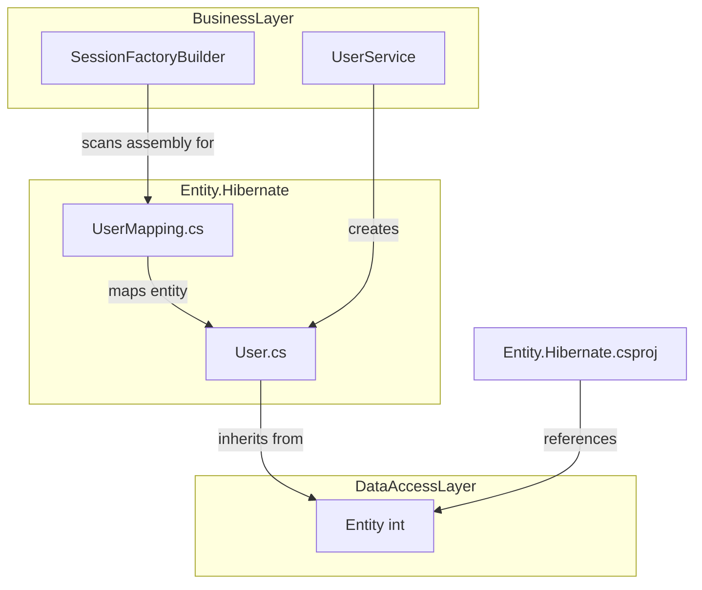

### Purpose

`Entity.Hibernate` is a .NET class library that defines NHibernate-mapped domain entities and their corresponding Fluent NHibernate mappings. It serves as the bridge between the application's domain model and the relational database schema, specifically for the `User` entity. This directory contains only the definition of persistent objects and their column mappings; it does not contain business logic, data access repositories, or session factory configuration.

### Software Components

The project consists of two core source files that work in tandem:

*   **`User.cs`**: Defines the `User` domain class. It inherits from `Entity<int>` in the `DataAccessLayer` project, which provides the `Id` property and `IEntity<int>` implementation. The class exposes `FirstName`, `LastName`, and `IsActive` as `virtual` properties to satisfy NHibernate’s runtime proxying requirements.
*   **`UserMapping.cs`**: Defines the Fluent NHibernate mapping for `User`. It specifies that `User` maps to a `Users` table, with `Id` as a database identity primary key and the other properties as non-nullable columns. This file dictates the database schema shape for the `User` entity.

The project also includes `Entity.Hibernate.csproj`, which configures the build for `net10.0`, enables nullable reference types, and references `NHibernate` and `FluentNHibernate` packages.

### Relationships

The dependency flow is strictly one-way: `UserMapping.cs` depends on `User.cs` for the entity definition, and both depend on the `DataAccessLayer` project for the base `Entity<TKey>` class. `User` is consumed by the `BusinessLayer` project, specifically `UserService`, which creates `User` instances and persists them. The `BusinessLayer` also configures NHibernate to scan this assembly for mappings, allowing `SessionFactoryBuilder` to discover `UserMapping.cs` automatically via `FluentMappings.AddFromAssembly`.

There is no direct code dependency between `User.cs` and `UserMapping.cs`; they are linked by convention (the `ClassMap<User>` generic parameter). Changing the property names in `User.cs` will break the compilation of `UserMapping.cs`, but changing the table name in `UserMapping.cs` only affects the database schema, not the C# class structure.

### Rough edges

The `GetActiveUsers` method in `UserService` is named for active users but does not filter by `IsActive` in its query, potentially returning all users. Additionally, `UserService.AddUser` always creates users with `IsActive = true`, and there is no current mechanism to deactivate a user.

## Contents
- [Entity.Hibernate.csproj](Entity.Hibernate/Entity.Hibernate.md)
- [User.cs](Entity.Hibernate/User.md)
- [UserMapping.cs](Entity.Hibernate/UserMapping.md)