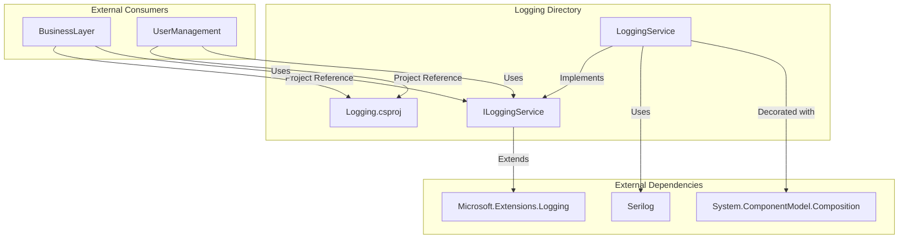

### Purpose

The `Logging` directory is a .NET class library that provides a unified logging facade for the application. It wraps the `Microsoft.Extensions.Logging` infrastructure and Serilog to expose a simpler, level-specific API for other parts of the codebase. The files belong together because they define the contract (`ILoggingService`) and the concrete implementation (`LoggingService`) that consumers depend on for diagnostic output.

### Software Components

The directory contains two main source code components:

*   **`ILoggingService`**: This is the primary interface for logging operations. It extends `Microsoft.Extensions.Logging.ILogger` and adds convenience methods for each log level (e.g., `LogInformation`, `LogError`). These methods allow callers to log messages, exceptions, and event IDs without manually constructing the generic `ILogger` calls. [ILoggingService.cs](Logging/ILoggingService.md) defines this contract.
*   **`LoggingService`**: This is the concrete implementation of `ILoggingService`. It uses Serilog as the underlying logging engine, configuring sinks for file output (daily rolling files) and the debug console. It is marked with the MEF `[Export(typeof(ILoggingService))]` attribute, which enables it to be injected into consumer classes via dependency injection. [LoggingService.cs](Logging/LoggingService.md) contains this implementation.

The [Logging.csproj](Logging/Logging.md) file defines the build settings for this assembly, targeting `net10.0` and referencing the necessary Serilog and Microsoft.Extensions.Logging packages.

### Relationships

The `Logging` library acts as a dependency for the `BusinessLayer` and `UserManagement` projects. These projects reference `Logging.csproj` and inject `ILoggingService` into their services and view models. The dependency flows strictly inward: consumers rely on the `ILoggingService` contract, while `LoggingService` relies on Serilog and Microsoft.Extensions.Logging packages.

Because `LoggingService` is exported via MEF, any class declaring an `ILoggingService` property will automatically receive the Serilog-backed implementation at runtime. This means that changing the logging configuration (e.g., log levels or file paths) requires modifying `LoggingService.cs` directly, as there is no external configuration file driving these settings.

## Contents
- [ILoggingService.cs](Logging/ILoggingService.md)
- [Logging.csproj](Logging/Logging.md)
- [LoggingService.cs](Logging/LoggingService.md)