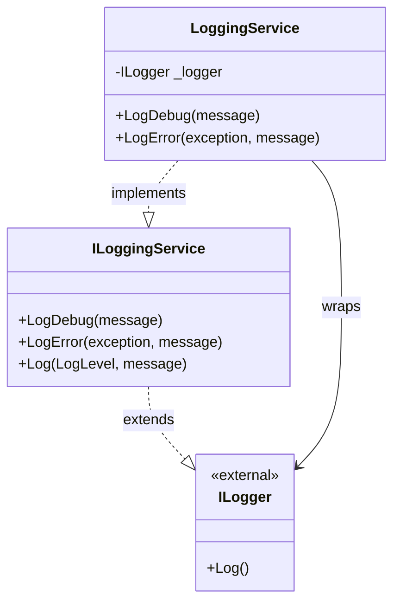

### Purpose

The `Logging` directory contains the application's logging abstraction, consisting of an interface definition and its concrete implementation. It provides a unified, MEF-composable facade that wraps Serilog, allowing business logic and view models to log without directly interacting with the underlying logging framework. These files belong together because they define the contract (`ILoggingService`) and the single runtime provider (`LoggingService`) for that contract, isolating the rest of the codebase from the specifics of Serilog configuration and sink management.

### Software Components

The directory contains two source code files that form a classic interface-implementation pair.

`Logging/ILoggingService.cs` defines the [ILoggingService](Logging/ILoggingService.md) interface. This interface extends `Microsoft.Extensions.Logging.ILogger` but adds a layer of convenience by introducing string-based overloads for each log level (Debug, Trace, Information, Warning, Error, Critical). It simplifies call sites by allowing developers to pass formatted strings and exception objects directly, rather than dealing with the complex `TState` and formatter delegates required by the base framework interface.

`Logging/LoggingService.cs` contains the [LoggingService](Logging/LoggingService.md) class, which is the sole implementation of `ILoggingService`. This class is responsible for initializing the Serilog logger instance within its field initializer, configuring enrichers, sinks (file and debug window), and minimum log levels. It marks the class with `[Export(typeof(ILoggingService))]` to register it with the MEF composition container. All logging methods within this class are thin delegates that forward calls to the internal Serilog-backed `ILogger` instance.

### Relationships

The relationship between these two files is a direct dependency: `LoggingService` implements `ILoggingService`. The rest of the application (such as `BusinessLayer` and `UserManagement`) depends only on the `ILoggingService` interface, receiving the `LoggingService` instance via MEF injection. This decoupling ensures that if the underlying logging engine changes, only `LoggingService` needs to be modified, while the interface contract remains stable for consumers.

### Rough edges

*   `ShowUsersViewModel` imports `ILoggingService` but never actually invokes any logging methods, resulting in a dead dependency.
*   The `LogTrace` methods are defined in the interface and implemented in `LoggingService`, but the Serilog configuration sets the minimum level to `Debug`, meaning all `Trace` logs are silently discarded at runtime.
*   The `CategoryName` enricher in `LoggingService` is configured with an empty string, so the `{CategoryName}` placeholder in the debug sink output always renders as blank, adding noise without providing diagnostic value.

## Contents
- [ILoggingService.cs](Logging/ILoggingService.md)
- [LoggingService.cs](Logging/LoggingService.md)