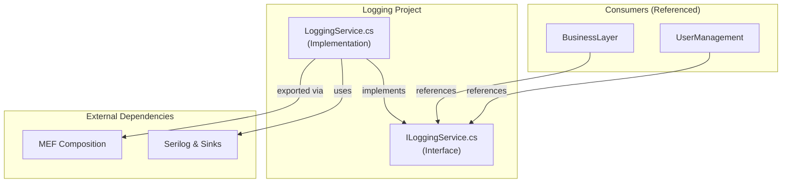

### Purpose

The `Logging` project is a small, self-contained class library responsible for providing the application's logging capabilities. It encapsulates the use of Serilog behind a simplified contract, ensuring that all log output is written to both a daily-rolling file and the debugger with thread-specific context. The directory contains only two files because the library is minimal: one defines the interface consumed by the rest of the codebase, and the other provides the sole implementation.

### Software Components

The directory consists of two distinct components that work together to form the logging layer:

*   **`ILoggingService`** ([Logging/ILoggingService.cs](Logging/ILoggingService.md)): This is the public contract for logging. It extends Microsoft's `ILogger` to provide a more developer-friendly API. While the base `ILogger` requires generic state and formatters, `ILoggingService` adds convenient string-based overloads for each log level (e.g., `LogError`, `LogInformation`). This allows callers to write simple, readable log statements without worrying about `EventId` or message formatting functions.
*   **`LoggingService`** ([Logging/LoggingService.cs](Logging/LoggingService.md)): This is the concrete implementation of `ILoggingService`. It uses Serilog as the underlying engine, configuring it to enrich every log entry with thread ID, thread name, and a category name. It also sets up the sinks for daily file rolling and debugger output. The class is marked with MEF attributes, allowing it to be injected into other parts of the application via dependency composition.

### Relationships

The relationship between the two files is a standard interface-implementation pattern. `LoggingService` depends on `ILoggingService` to define its public behavior, and `ILoggingService` relies on `LoggingService` to provide the actual logging functionality.

Externally, the `Logging` project is referenced by `BusinessLayer` and `UserManagement`. However, a critical aspect of the current state is that while these projects reference the library, no code in the repository currently uses the `[Import]` attribute to consume the `ILoggingService` export. The `LoggingService` is available for injection but is not actively utilized by any caller in the provided codebase.

The internal dependency flow is straightforward:
1.  Application code (if it were active) would depend on `ILoggingService`.
2.  The MEF composition container resolves `ILoggingService` to the `LoggingService` instance.
3.  `LoggingService` forwards all calls to its internal Serilog `ILogger` instance.

### Rough edges

*   **Unconsumed Export:** The `LoggingService` is marked for MEF export, but no `[Import]` statements for `ILoggingService` exist in the `BusinessLayer` or `UserManagement` projects. This means the logging infrastructure is currently built but not actively used by any application code.
*   **Hardcoded Configuration:** The log file name (`Hargassner.Teststand-.log`) and retention policy are hardcoded within `LoggingService`. There is no configuration surface to change these values, making the "shared" library somewhat specific to a single project's naming conventions.
*   **Dead Code in Interface:** The `ILoggingService` interface defines a large grid of overloads (including `EventId` variants and `LogTrace`), but the only actual usage in the codebase is a single `LogError` call. Most of the interface surface is unused.

## Contents
- [ILoggingService.cs](Logging/ILoggingService.md)
- [LoggingService.cs](Logging/LoggingService.md)