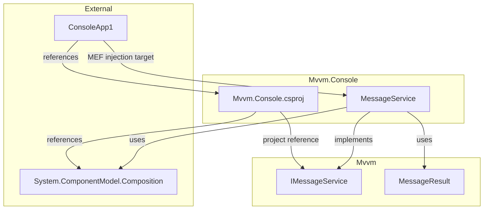

### Purpose

`Mvvm.Console` is a .NET class library that provides a console-based implementation of the `IMessageService` interface defined in the `Mvvm` project. Its sole responsibility is to enable ViewModels to display messages, warnings, and errors to a console user via colored text output. This directory exists to allow console applications to host the shared Mvvm infrastructure without requiring WPF or WinForms dependencies, serving as one of three sibling implementations (alongside `Mvvm.Wpf` and `Mvvm.Winforms`) for the same contract.

### Software Components

The library consists of two primary artifacts:

*   **`MessageService`**: Defined in [MessageService.cs](Mvvm.Console/MessageService.md), this class is the core component. It is decorated with `[Export(typeof(IMessageService))]` to make it discoverable via MEF. It implements the `ShowMessage`, `ShowWarning`, and `ShowError` methods by writing to `Console.Out` or `Console.Error` with specific foreground colors (white, yellow, and red, respectively). The three question methods (`ShowYesNoCancelQuestion`, `ShowYesNoQuestion`, `ShowOkCancelQuestion`) are present to satisfy the interface but throw `NotImplementedException`, as modal dialogs are not feasible in a standard console host.
*   **Project Definition**: Defined in [Mvvm.Console.csproj](Mvvm.Console/Mvvm.Console.md), this file configures the library to target `net10.0-windows` and establishes the dependency on the `Mvvm` project for the interface definition and on `System.ComponentModel.Composition` for MEF support.

### Relationships

`Mvvm.Console` depends strictly on the `Mvvm` project to satisfy the `IMessageService` contract. It does not reference other host-specific projects (`Mvvm.Wpf` or `Mvvm.Winforms`), ensuring that a console host remains lightweight. Conversely, consumer projects like `ConsoleApp1` reference `Mvvm.Console` to allow MEF to inject the console-specific `MessageService` into ViewModels that import `IMessageService`. The dependency direction is strictly outward from the consumer to this library, and from this library to the core `Mvvm` abstraction.

### Rough edges

*   The question methods in [MessageService](Mvvm.Console/MessageService.md) throw `NotImplementedException` rather than providing a fallback, meaning any ViewModel attempting to show a question in a console app will crash at runtime.
*   The `ShowMessage` and `ShowWarning` methods permanently alter the console foreground color and do not restore the previous color, which can affect subsequent non-Mvvm output in the console.

## Contents
- [MessageService.cs](Mvvm.Console/MessageService.md)
- [Mvvm.Console.csproj](Mvvm.Console/Mvvm.Console.md)