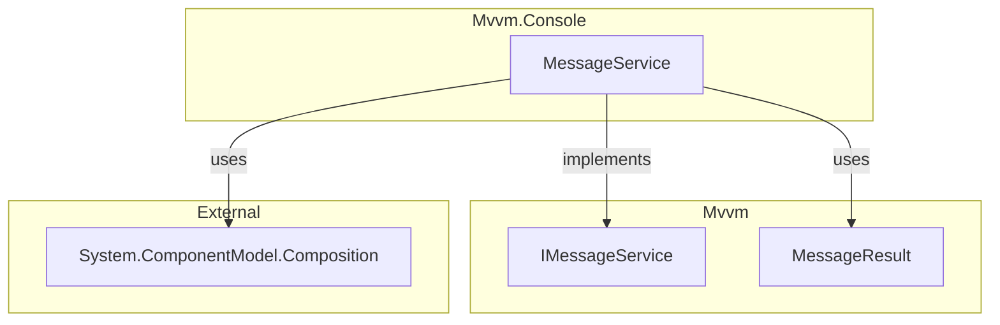

### Purpose

The `Mvvm.Console` directory is a class library that provides the console-host implementation of the `IMessageService` interface. Its responsibility is to allow ViewModels in the framework-agnostic `Mvvm` project to display messages, warnings, and errors via colored terminal text, without introducing dependencies on WPF or WinForms. This directory contains a single source file, which acts as the adapter for the messaging contract in console applications.

### Software Components

The directory contains exactly one source component: `MessageService`.

-   `MessageService.cs`: Defines the `MessageService` class, which implements `IMessageService`. It uses MEF (`[Export(typeof(IMessageService))]`) for dependency injection. The class handles `ShowMessage`, `ShowWarning`, and `ShowError` by writing colored text to `System.Console`. It includes stub implementations for question methods (`ShowYesNoCancelQuestion`, etc.) that throw `NotImplementedException` because a console cannot present modal dialogs.

### Relationships

`MessageService` depends on the `Mvvm` project for the `IMessageService` interface and the `MessageResult` enum. It relies on `System.ComponentModel.Composition` for MEF-based discovery. The class does not depend on any other UI framework. Callers, such as ViewModels in other parts of the solution, depend on the `IMessageService` interface and receive this specific implementation via MEF composition when running in a console host.

### Rough edges

-   The question methods (`ShowYesNoCancelQuestion`, etc.) throw `NotImplementedException` rather than degrading to text prompts, causing runtime crashes if a console-hosted ViewModel triggers a dialog.
-   `ShowMessage`, `ShowWarning`, and `ShowError` set `System.Console.ForegroundColor` but never restore it, causing color state to leak into subsequent unrelated console output.

## Contents
- [MessageService.cs](Mvvm.Console/MessageService.md)