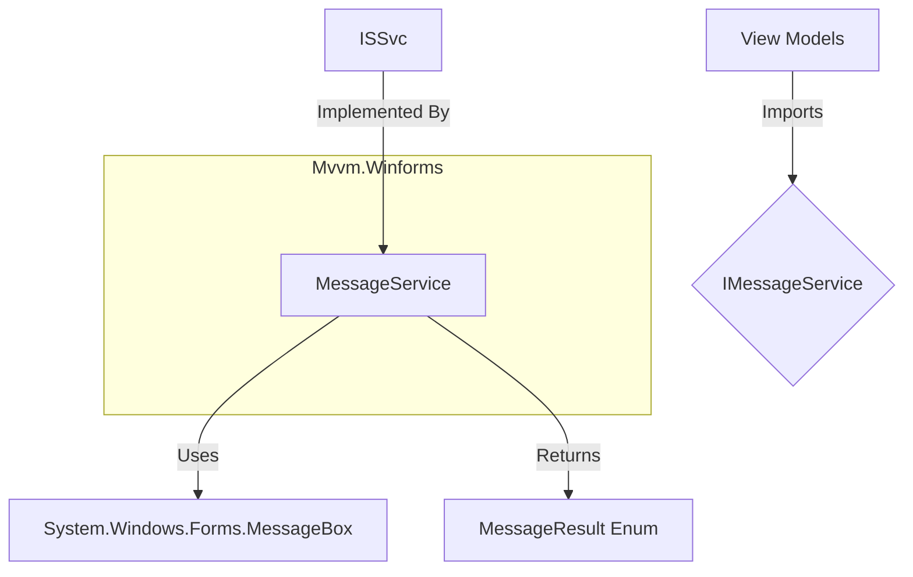

### Purpose

The `Mvvm.Winforms` project serves as a thin UI adapter that allows framework-agnostic view models to display modal message boxes in a WinForms environment. It isolates the underlying WinForms dependency from the core application logic, ensuring that business logic remains portable. The entire functional surface of this project consists of a single component that implements the `IMessageService` interface.

### Software Components

This directory contains one primary source file, `MessageService.cs`, which defines the `MessageService` class. This class acts as the WinForms-specific implementation of the `IMessageService` contract. It maps the nine interface methods directly to `System.Windows.Forms.MessageBox.Show` calls, selecting the appropriate buttons and icons for each scenario. The class is decorated with MEF attributes, allowing a `CompositionContainer` to discover and inject it into view models at runtime. It sits alongside sibling implementations in `Mvvm.Wpf` and `Mvvm.Console`, serving as the counterpart for WinForms-hosted applications.

### Relationships

`MessageService` depends on `System.Windows.Forms.MessageBox` for all rendering logic. It implements the `IMessageService` interface defined in `Mvvm/IMessageService.cs` and returns the `MessageResult` enum from `Mvvm/MessageResult.cs`. The dependency flows from the view models, which import `IMessageService`, through this adapter, down to the WinForms UI. Because the implementation is discovered via MEF exports, the specific host project determines which assembly (and thus which `MessageService` class) is loaded.

### Rough edges

The conversion from `MessageBoxResult` to `MessageResult` relies on a direct cast that assumes the numeric values of the two enums are identical. There is no shared definition or compile-time check to ensure they remain in sync; if either enum is modified independently, the cast will silently produce incorrect results.

## Contents
- [MessageService.cs](Mvvm.Winforms/MessageService.md)