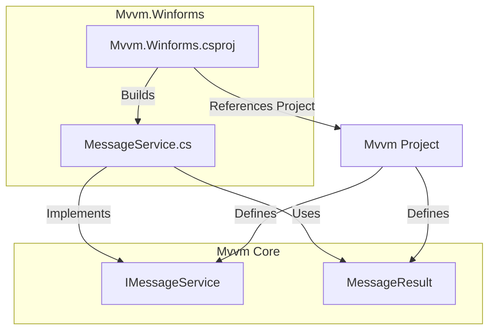

### Purpose

`Mvvm.Winforms` is a thin WinForms adapter that provides a concrete implementation of the `IMessageService` interface defined in the core `Mvvm` project. It exists to allow framework-agnostic view-models to display standard Windows dialogs (messages, warnings, errors, and yes/no questions) without referencing WinForms types directly. The directory contains only the project file and a single source file, keeping the dependency footprint minimal and focused strictly on UI interaction.

### Software Components

The primary component is [MessageService](Mvvm.Winforms/MessageService.md), a class that implements the `IMessageService` contract. It wraps `System.Windows.Forms.MessageBox` calls to expose a unified interface for user notifications. The class is decorated with MEF attributes, making it available for composition into dependent view-models at runtime.

The [Mvvm.Winforms.csproj](Mvvm.Winforms/Mvvm.Winforms.md) file defines the build configuration for this library. It targets `net10.0-windows`, enables the Windows Forms runtime, and establishes a single project reference to the `Mvvm` core project.

### Relationships

`Mvvm.Winforms` acts as a leaf node in the dependency graph, relying entirely on the `Mvvm` project for its interface definitions and transitive dependencies like `CommunityToolkit.Mvvm`. It does not define any abstractions used by other layers; its sole responsibility is fulfilling the `IMessageService` contract for WinForms hosts.

The implementation in [MessageService](Mvvm.Winforms/MessageService.md) relies on a specific numerical alignment between the `MessageResult` enum (from `Mvvm`) and WinForms' `MessageBoxButtons` enum. This allows direct casting of the dialog results without conversion logic. Host applications, such as `WinFormsApp1`, reference this project to inject the WinForms-specific message service into their view-models via MEF.

## Contents
- [MessageService.cs](Mvvm.Winforms/MessageService.md)
- [Mvvm.Winforms.csproj](Mvvm.Winforms/Mvvm.Winforms.md)