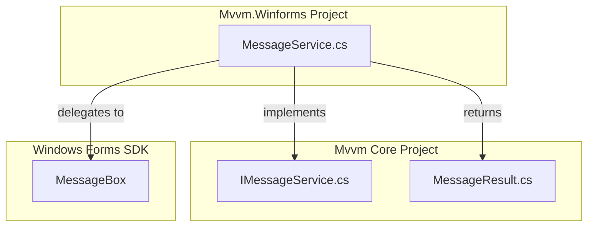

### Purpose

`Mvvm.Winforms` is a thin adapter layer that provides the WinForms implementation of the `IMessageService` contract. It exists to allow framework-agnostic view models to display modal dialogs without referencing WinForms types directly. The directory contains a single class, `MessageService`, which acts as a bridge between the shared `Mvvm` project and the native `System.Windows.Forms.MessageBox` API.

### Software Components

The entire functional surface of this project consists of the `MessageService` class found in [`Mvvm.Winforms/MessageService.cs`](Mvvm.Winforms/MessageService.md). This class implements `IMessageService` and exposes nine methods for displaying information, warnings, errors, and questions. Each method is a thin wrapper that translates interface calls into specific `MessageBox.Show` invocations with appropriate icons and button configurations. The class is marked with `[Export(typeof(IMessageService))]`, registering it for MEF (Managed Extensibility Framework) discovery so that view models can consume it via dependency injection.

### Relationships

This project functions as a satellite to the core `Mvvm` project, which defines the `IMessageService` interface and the `MessageResult` enum. `MessageService` depends on the `Mvvm` project for these contracts and on the Windows Forms library for UI rendering. It is one of three interchangeable platform implementations (alongside Console and WPF versions), with the active instance selected at runtime by MEF composition.

View models in other projects, such as `UserManagement/ViewModel/AddUserViewModel.cs`, import `IMessageService` and call methods like `ShowError`. At runtime, the MEF container resolves this import to the `MessageService` instance provided by this project, provided the assembly is loaded. The dependency direction is strictly one-way: `Mvvm.Winforms` depends on `Mvvm`, but `Mvvm` has no knowledge of this project.

## Contents
- [MessageService.cs](Mvvm.Winforms/MessageService.md)