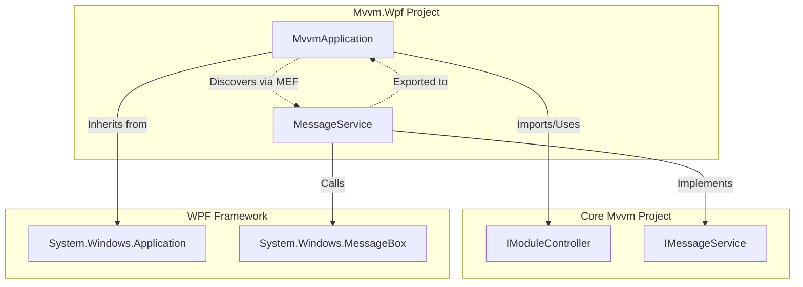

### Purpose

The `Mvvm.Wpf` project serves as the WPF-specific host layer for the repository's MEF-based MVVM framework. Its primary responsibility is to provide a ready-made application shell that handles container composition, module lifecycle management, and global exception handling, allowing WPF applications to focus on business logic rather than bootstrapping infrastructure.

Its contents belong together because they form a complete WPF binding for the shared `Mvvm` core: one component (`MvvmApplication`) manages the application startup and shutdown, while the other (`MessageService`) abstracts the platform-specific UI messaging. Together, they allow WPF hosts to plug into the framework via XAML inheritance and MEF exports, mirroring the patterns established in the `Mvvm.Console` and `Mvvm.Winforms` sibling projects.

### Software Components

This directory contains two distinct functional components, each defined in its own C# file:

*   **Application Lifecycle Management**: `MvvmApplication.cs` defines the base `Application` class that WPF apps inherit from. It encapsulates the complex startup sequence, including scanning assemblies for MEF exports, creating the composition container, and executing the ordered `Initialize` and `Run` phases of all modules. It also manages the reverse-order shutdown and registers global exception handlers for both the UI dispatcher and the application domain.
*   **UI Message Abstraction**: `MessageService.cs` implements the `IMessageService` interface from the core `Mvvm` project. It acts as a thin adapter that translates interface method calls into native `System.Windows.MessageBox` invocations. By exporting itself via MEF, it ensures that any view model importing `IMessageService` is wired to this WPF-specific implementation without needing to reference WPF types directly.

### Relationships

The two components operate independently but within the same MEF-composition context established by the application host. `MvvmApplication` is the entry point that constructs the environment in which `MessageService` becomes available.

1.  **Bootstrapping and Dependency Injection**: `MvvmApplication.OnStartup` uses `CompositionHelper` to build a `CompositionContainer`. This container scans loaded assemblies for types decorated with `[Export]`. `MessageService` is one such exported type (`[Export(typeof(IMessageService))]`). Consequently, any other module or view model that declares `[Import] IMessageService` will be injected with an instance of `Mvvm.Wpf.MessageService` at runtime.
2.  **Isolation of Concerns**: `MvvmApplication` does not directly interact with `MessageService` for its core logic. It uses `Console.WriteLine` for fatal startup errors (a known limitation in WPF) and a hardcoded `MessageBox` for the "No module found" scenario. This separation means `MessageService` is only utilized by the *content* modules (view models) discovered during the startup process, not by the shell itself for its internal errors.
3.  **Project Structure**: The `Mvvm.Wpf.csproj` file ties these components together by referencing the core `Mvvm` project (for interfaces like `IMessageService` and `IModuleController`) and enabling WPF support. It ensures that both the application base class and the message service are compiled into a single library assembly for WPF hosts.

### Rough edges

*   **Inconsistent Error Reporting**: `MvvmApplication` reports fatal startup errors (like reflection failures) to the `Console`, which is invisible in WPF applications, resulting in a silent exit. In contrast, the "No module found" error uses a `MessageBox`.
*   **Language Mismatch**: The error dialog shown by `MvvmApplication` when an unhandled exception occurs is in German ("Es ist ein Fehler aufgetreten."), while the "No module found" message is in English.
*   **Enum Coupling**: `MessageService` relies on a direct cast between WPF's `MessageBoxResult` and the core project's `MessageResult` enum. These must maintain identical numeric values to avoid silent data corruption, a fragile dependency not enforced by the compiler.

## Contents
- [MessageService.cs](Mvvm.Wpf/MessageService.md)
- [Mvvm.Wpf.csproj](Mvvm.Wpf/Mvvm.Wpf.md)
- [MvvmApplication.cs](Mvvm.Wpf/MvvmApplication.md)