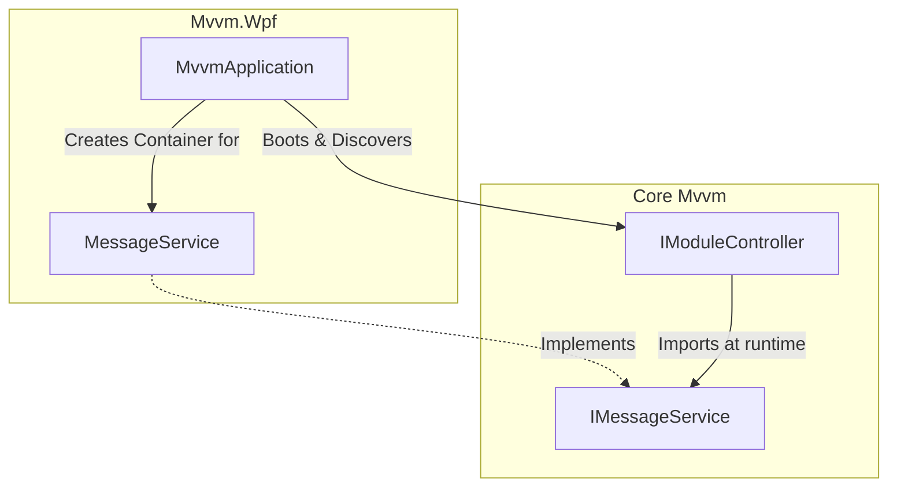

### Purpose

`Mvvm.Wpf` is a .NET library that enables WPF applications to run on the codebase's modular MVVM architecture. It provides two distinct capabilities: it acts as a host for the application lifecycle and it supplies the concrete implementation for UI messaging. These components belong together because they are the only parts of the framework that depend directly on WPF-specific APIs (`System.Windows.Application` and `System.Windows.MessageBox`), keeping other parts of the codebase framework-agnostic.

### Software Components

This directory contains two main components, each in its own file:

*   **`MvvmApplication`**: Found in [MvvmApplication.cs](Mvvm.Wpf/MvvmApplication.md), this is the base class for WPF `Application` objects. It encapsulates the entire MEF bootstrap process, including assembly scanning, container creation, module discovery, and lifecycle management (`Initialize`, `Run`, `Shutdown`). A WPF project uses this by deriving a concrete `App` class from it, requiring no additional bootstrap code.
*   **`MessageService`**: Found in [MessageService.cs](Mvvm.Wpf/MessageService.md), this class implements the `IMessageService` interface from the core `Mvvm` project. It wraps WPF’s `MessageBox.Show` to provide view models with a way to display messages, warnings, errors, and questions without depending on WPF types directly. It is exported via MEF so it can be injected into view models.

### Relationships

The two components operate independently but are both essential for a functioning WPF host. `MvvmApplication` drives the startup sequence and creates the `CompositionContainer` that discovers and registers modules. It does not directly interact with `MessageService` during bootstrap; rather, `MessageService` is discovered by MEF during the module initialization phase if a view model requires it.

The dependency flow is straightforward:
1.  The WPF host inherits from `MvvmApplication`.
2.  `MvvmApplication.OnStartup` triggers the MEF composition, which registers `MessageService` as an export.
3.  View modules, when initialized, import `IMessageService` and receive an instance of `MessageService`.

### Rough edges

The error handling in `MvvmApplication` writes fatal startup errors to the console, which is invisible in WPF apps, leading to silent exits with no user feedback. Additionally, the user-facing error messages are inconsistently localized, with some in English and others in German.

## Contents
- [MessageService.cs](Mvvm.Wpf/MessageService.md)
- [MvvmApplication.cs](Mvvm.Wpf/MvvmApplication.md)