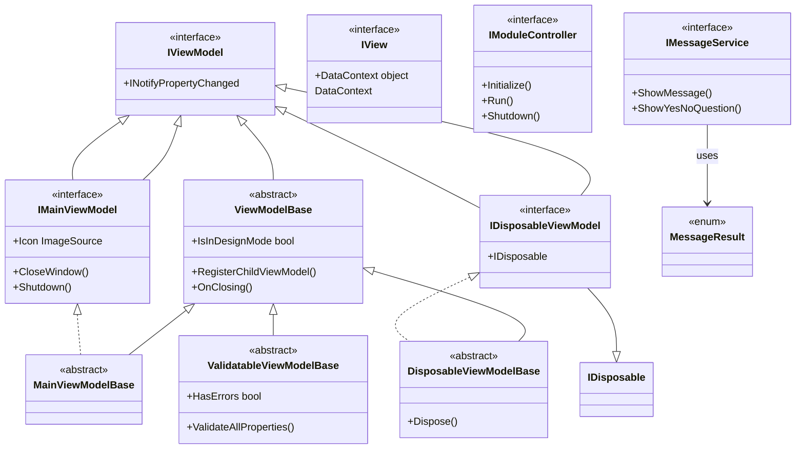

### Purpose

The `Mvvm` project serves as the framework-agnostic core of the application's MVVM architecture. It provides the abstract base classes, interfaces, and shared types that define how ViewModels behave, how Views connect to them, and how application modules communicate with the user interface.

The contents belong together because they form the contract layer between the business logic (feature modules like `UserManagement`) and the specific UI technologies (WPF or WinForms). By centralizing the `ViewModelBase` hierarchy, the `IView` contract, and the `IMessageService` abstraction here, the project ensures that feature code remains testable and UI-agnostic, while the host applications only need to implement the specific glue code for their respective frameworks.

### Software Components

The components in this directory group into three functional layers:

**View-Model Base Hierarchy**
The foundation of the library is the inheritance chain starting at [ViewModelBase](Mvvm/ViewModelBase.md). It extends CommunityToolkit's `ObservableObject` to provide property change notification, design-mode detection, and a parent-child tree structure for managing nested ViewModels. Derived from this are three specialized bases:
*   [ValidatableViewModelBase](Mvvm/ValidatableViewModelBase.md) adds support for `FluentValidation` and surfaces errors via `INotifyDataErrorInfo`.
*   [DisposableViewModelBase](Mvvm/DisposableViewModelBase.md) implements the standard dispose pattern for ViewModels that manage unmanaged or external resources.
*   [MainViewModelBase](Mvvm/MainViewModelBase.md) handles the lifecycle of the application's main window, including icon loading and shutdown logic.

**View and ViewModel Contracts**
The interfaces define the boundary between the model and the view:
*   [IViewModel](Mvvm/IViewModel.md) is the root marker interface for all ViewModels, extending `INotifyPropertyChanged`.
*   [IMainViewModel](Mvvm/IMainViewModel.md) adds window-specific controls like `CloseWindow()` and `Shutdown()` to the ViewModel contract.
*   [IDisposableViewModel](Mvvm/IDisposableViewModel.md) marks ViewModels that must be explicitly disposed.
*   [IView](Mvvm/IView.md) defines the minimal view contract, primarily through the `DataContext` property which serves as the binding point for the ViewModel.
*   [IDialogView](Mvvm/IDialogView.md) and [IMainView](Mvvm/IMainView.md) extend `IView` with specific behaviors for dialogs and the main application window, respectively.

**Messaging and Module Lifecycle**
*   [IMessageService](Mvvm/IMessageService.md) abstracts the UI framework's message boxes, allowing ViewModels to display warnings, errors, and questions without referencing WPF or WinForms types directly.
*   [MessageResult](Mvvm/MessageResult.md) is an enum that standardizes the return values of user interactions (Yes/No/Cancel) across different UI frameworks.
*   [IModuleController](Mvvm/IModuleController.md) defines the lifecycle contract (`Initialize`, `Run`, `Shutdown`) for application modules, allowing hosts to start and stop features uniformly.

### Relationships

The dependency structure follows a strict layering: concrete application code depends on these abstractions, but these abstractions do not depend on the specific UI host. The `ViewModelBase` class is the central hub; it implements `IViewModel` and is the parent to the specialized bases. For instance, a concrete ViewModel like `UserViewModel` might derive from `MainViewModelBase` (which derives from `ViewModelBase`) and implement `IMainViewModel`.

The messaging subsystem relies on the [MessageResult](Mvvm/MessageResult.md) enum to translate platform-specific results into a common type. The `IModuleController` interface is the entry point for the host applications (WPF/WinForms), which use MEF to discover and drive the lifecycle of these modules. The `Common` project is a dependency for `Mvvm` (specifically for `ExtendedGuard` in `ViewModelBase`), but no other external dependencies exist within the `Mvvm` project itself beyond the NuGet packages for CommunityToolkit and FluentValidation.

## Contents
- [DisposableViewModelBase.cs](Mvvm/DisposableViewModelBase.md)
- [IDialogView.cs](Mvvm/IDialogView.md)
- [IDisposableViewModel.cs](Mvvm/IDisposableViewModel.md)
- [IMainView.cs](Mvvm/IMainView.md)
- [IMainViewModel.cs](Mvvm/IMainViewModel.md)
- [IMessageService.cs](Mvvm/IMessageService.md)
- [IModuleController.cs](Mvvm/IModuleController.md)
- [IView.cs](Mvvm/IView.md)
- [IViewModel.cs](Mvvm/IViewModel.md)
- [MainViewModelBase.cs](Mvvm/MainViewModelBase.md)
- [MessageResult.cs](Mvvm/MessageResult.md)
- [Mvvm.csproj](Mvvm/Mvvm.md)
- [ValidatableViewModelBase.cs](Mvvm/ValidatableViewModelBase.md)
- [ViewModelBase.cs](Mvvm/ViewModelBase.md)