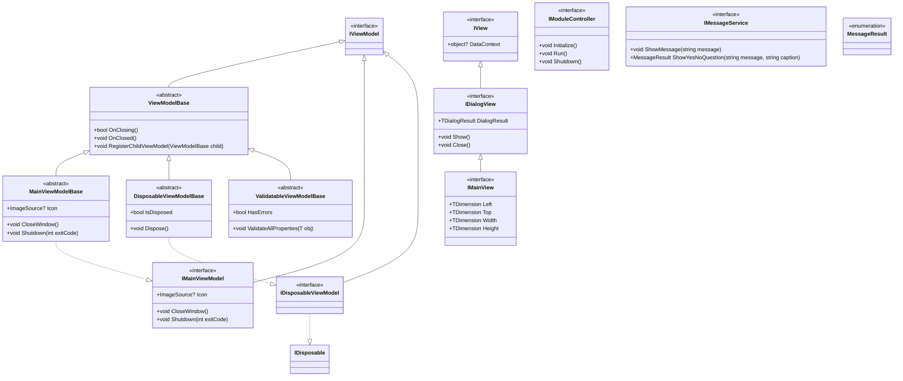

# Mvvm

### Purpose

The `Mvvm` directory serves as the framework-agnostic core for a modular, multi-host MVVM application. It defines the shared abstractions—view-model base classes, view interfaces, and service contracts—that allow the same business logic to run on WPF, WinForms, or Console hosts without modification.

These files belong together because they form the dependency root for all host applications (`WpfApp1`, `WinFormsApp1`) and feature modules (like `UserManagement`). They contain no UI-specific code, only contracts and base infrastructure that enforce the MVVM pattern and enable runtime module discovery via MEF.

### Software Components

The directory contains source code structured into four logical groups:

**1. View-Model Hierarchy**
This is the central component, providing the base classes for all view models.
*   [`ViewModelBase`](Mvvm/ViewModelBase.md) is the root abstract class. It inherits from `ObservableObject` (CommunityToolkit.Mvvm) and implements [`IViewModel`](Mvvm/IViewModel.md). It handles property change notification, design-mode detection, and a child-view-model registry that propagates `OnClosing`/`OnClosed` events through the object tree.
*   [`MainViewModelBase`](Mvvm/MainViewModelBase.md) extends `ViewModelBase` to implement [`IMainViewModel`](Mvvm/IMainViewModel.md). It manages main-window-specific concerns: loading the application icon, handling the window's `Closing` event to trigger the view-model shutdown sequence, and providing `Shutdown(int)` and `CloseWindow()` methods.
*   [`DisposableViewModelBase`](Mvvm/DisposableViewModelBase.md) extends `ViewModelBase` to implement [`IDisposableViewModel`](Mvvm/IDisposableViewModel.md). It adds standard .NET disposal patterns (`Dispose()`, `IsDisposed`) and a `Disposables` collection for managing owned resources.
*   [`ValidatableViewModelBase`](Mvvm/ValidatableViewModelBase.md) extends `ViewModelBase` to add FluentValidation support. It implements `INotifyDataErrorInfo`, allowing view models to expose validation errors for data binding without manual error plumbing.

**2. View Interface Hierarchy**
These interfaces define the contract for UI windows, ensuring controllers can interact with views without knowing the underlying toolkit.
*   [`IView`](Mvvm/IView.md) is the root interface, exposing a single `DataContext` property.
*   [`IDialogView`](Mvvm/IDialogView.md) extends `IView`, adding `Show()`, `Close()`, lifecycle events (`Closing`, `Closed`), and a generic `DialogResult`.
*   [`IMainView`](Mvvm/IMainView.md) extends `IDialogView`, adding geometry properties (`Left`, `Top`, `Width`, `Height`) with a generic `TDimension` type parameter to support both `int` (WinForms) and `double` (WPF) coordinates.

**3. Application Lifecycle & Services**
*   [`IModuleController`](Mvvm/IModuleController.md) is the contract for application modules. It defines the three-phase lifecycle: `Initialize()`, `Run()`, and `Shutdown()`. Hosts use MEF to discover classes exporting this interface to start the application.
*   [`IMessageService`](Mvvm/IMessageService.md) is the contract for displaying message boxes. It abstracts user feedback (errors, warnings, questions) away from the specific UI toolkit.
*   [`MessageResult`](Mvvm/MessageResult.md) is a platform-neutral enum used by `IMessageService` to return user choices. Its values are numerically aligned with WPF and WinForms result enums to allow safe casting in satellite projects.

**4. Supporting Markers**
*   [`IViewModel`](Mvvm/IViewModel.md) and [`IDisposableViewModel`](Mvvm/IDisposableViewModel.md) are marker interfaces that establish type identity for view models and disposable view models, respectively.
*   [`IMainViewModel`](Mvvm/IMainViewModel.md) extends `IViewModel` to add window control members (`Icon`, `CloseWindow`, `Shutdown`).

### Relationships

The architecture relies on strict separation between the `Mvvm` core (this directory) and the host implementations. The core defines *what* is needed; the hosts (WPF/WinForms) define *how* it is rendered.

**View-Model Chain:**
[`ViewModelBase`](Mvvm/ViewModelBase.md) is the foundation. [`MainViewModelBase`](Mvvm/MainViewModelBase.md), [`DisposableViewModelBase`](Mvvm/DisposableViewModelBase.md), and [`ValidatableViewModelBase`](Mvvm/ValidatableViewModelBase.md) all inherit from it. Concrete view models in feature projects (e.g., `UserViewModel`) inherit from one of these specialized bases. [`MainViewModelBase`](Mvvm/MainViewModelBase.md) is the only class that actively invokes the `OnClosing`/`OnClosed` lifecycle hooks defined in [`ViewModelBase`](Mvvm/ViewModelBase.md), effectively activating the child-view-model cleanup chain when the main window closes.

**View Contract Chain:**
[`IView`](Mvvm/IView.md) is the base, extended by [`IDialogView`](Mvvm/IDialogView.md), which is extended by [`IMainView`](Mvvm/IMainView.md). Host-specific windows (e.g., `UserView` in WPF, `UserForm` in WinForms) implement [`IMainView`](Mvvm/IMainView.md). Controllers depend on this interface, not the concrete window class.

**Module Discovery:**
Hosts (e.g., `WpfApp1`) create an MEF composition container and resolve all exports of [`IModuleController`](Mvvm/IModuleController.md). They then call `Initialize()` on all modules, followed by `Run()`. The `Run()` method typically instantiates the main view, assigns the [`IMainViewModel`](Mvvm/IMainViewModel.md) as the `DataContext`, and shows the window.

**Messaging:**
View models depend on [`IMessageService`](Mvvm/IMessageService.md) to show dialogs. They do not reference WPF or WinForms classes directly. The specific `MessageService` implementation is injected via MEF at runtime. When a question is asked, the service returns a [`MessageResult`](Mvvm/MessageResult.md) value, which the view model processes.

### Rough edges

*   **Naming Mismatch:** [`IDialogView`](Mvvm/IDialogView.md) and its `DialogResult` member suggest a modal dialog, but they are used to model the application's *main* non-modal window.
*   **Incomplete Shutdown Support:** [`IModuleController`](Mvvm/IModuleController.md) defines `Shutdown()`, but the WinForms host (`WinFormsApp1`) never calls it, leaving it as dead code for that platform.
*   **Unsafe Enum Casting:** [`MessageResult`](Mvvm/MessageResult.md) relies on unchecked casts in WPF/WinForms implementations that match its numeric values to platform enums. This is fragile and not enforced by the compiler.
*   **Thread Safety:** [`ValidatableViewModelBase`](Mvvm/ValidatableViewModelBase.md) clears and re-populates its error dictionary in `ValidateAllProperties` without thread safety, potentially causing inconsistent states if accessed from another thread.

## Contents
- [DisposableViewModelBase.cs](Mvvm/DisposableViewModelBase.md)
- [IDialogView.cs](Mvvm/IDialogView.md)
- [IDisposableViewModel.cs](Mvvm/IDisposableViewModel.md)
- [IMainView.cs](Mvvm/IMainView.md)
- [IMainViewModel.cs](Mvvm/IMainViewModel.md)
- [IMessageService.cs](Mvvm/IMessageService.md)
- [IModuleController.cs](Mvvm/IModuleController.md)
- [IView.cs](Mvvm/IView.md)
- [IViewModel.cs](Mvvm/IViewModel.md)
- [MainViewModelBase.cs](Mvvm/MainViewModelBase.md)
- [MessageResult.cs](Mvvm/MessageResult.md)
- [ValidatableViewModelBase.cs](Mvvm/ValidatableViewModelBase.md)
- [ViewModelBase.cs](Mvvm/ViewModelBase.md)