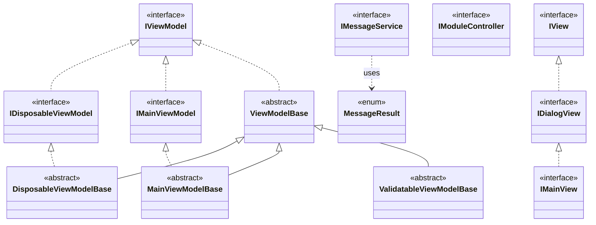

### Purpose

The `Mvvm` directory serves as the framework-agnostic core of the solution, defining the shared MVVM abstractions that allow feature modules to run across different UI hosts (WPF, WinForms, Console). It contains the root interfaces and base classes that provide observable state, view-model/view contract definition, and module lifecycle management, ensuring that business logic remains decoupled from specific UI frameworks.

### Software Components

The code is organized into three primary responsibility groups:

*   **View-Model Base Hierarchy**: This set of abstract classes provides the common infrastructure for all view models.
    *   `ViewModelBase` is the root, extending CommunityToolkit’s `ObservableObject` to provide `INotifyPropertyChanged` support, design-mode detection, and child view-model lifecycle hooks (`OnClosing`/`OnClosed`).
    *   [DisposableViewModelBase](Mvvm/DisposableViewModelBase.md) extends `ViewModelBase` to add deterministic disposal of `IDisposable` resources.
    *   [MainViewModelBase](Mvvm/MainViewModelBase.md) extends `ViewModelBase` to handle main-window-specific logic, including window icon loading and close/shutdown delegation.
    *   [ValidatableViewModelBase](Mvvm/ValidatableViewModelBase.md) extends `ViewModelBase` to integrate FluentValidation for data-binding errors.

*   **Core Contracts (Interfaces)**: These interfaces define the capabilities and roles of components without tying them to a UI framework.
    *   [IViewModel](Mvvm/IViewModel.md) is the marker interface for all view models, inheriting from `INotifyPropertyChanged`.
    *   [IMainViewModel](Mvvm/IMainViewModel.md) defines the contract for the main window's view model, adding window control members like `CloseWindow` and `Shutdown`.
    *   [IDisposableViewModel](Mvvm/IDisposableViewModel.md) marks view models that own disposable resources.
    *   [IModuleController](Mvvm/IModuleController.md) defines the lifecycle contract (`Initialize`, `Run`, `Shutdown`) for application modules.
    *   [IView](Mvvm/IView.md), [IDialogView](Mvvm/IDialogView.md), and [IMainView](Mvvm/IMainView.md) form the view-side hierarchy, allowing controllers to drive windows generically via `DataContext`, `Show`, `Close`, and geometry properties.

*   **Messaging Subsystem**: A platform-neutral way for view models to display dialogs.
    *   [IMessageService](Mvvm/IMessageService.md) defines the contract for showing messages and asking questions.
    *   [MessageResult](Mvvm/MessageResult.md) is a shared enum that maps user dialog responses, ensuring compatibility between WPF and WinForms result types.

### Relationships

The `Mvvm` project acts as the central dependency for host applications (`Mvvm.Wpf`, `WinFormsApp1`) and feature modules (like `UserManagement`). The relationships within the directory follow a clear layering from abstract contracts to concrete base implementations.

The view-model hierarchy is rooted at `ViewModelBase`, which implements [IViewModel](Mvvm/IViewModel.md). The specialized base classes ([DisposableViewModelBase](Mvvm/DisposableViewModelBase.md), [MainViewModelBase](Mvvm/MainViewModelBase.md), and [ValidatableViewModelBase](Mvvm/ValidatableViewModelBase.md)) all extend this root, allowing concrete view models to opt into specific capabilities (disposal, main-window control, or validation) without inheriting irrelevant logic. [MainViewModelBase](Mvvm/MainViewModelBase.md) specifically implements [IMainViewModel](Mvvm/IMainViewModel.md) and is the only base class that interacts with `Application.Current` to manage the window lifecycle.

The view interfaces follow a parallel path. [IView](Mvvm/IView.md) is the base, extended by [IDialogView](Mvvm/IDialogView.md), which is in turn extended by [IMainView](Mvvm/IMainView.md). These interfaces are consumed by [IModuleController](Mvvm/IModuleController.md) implementations in the host projects, which use them to wire up `DataContext` and control window visibility without knowing the specific UI framework.

The messaging subsystem is self-contained but relies on the module system for distribution. [IMessageService](Mvvm/IMessageService.md) is the interface consumed by feature view models, while [MessageResult](Mvvm/MessageResult.md) provides the return type. The actual implementations of `IMessageService` live in the host projects (WPF, WinForms, Console), but they must return the shared `MessageResult` enum to remain compatible with the core contract.

### Rough edges

- [MainViewModelBase](Mvvm/MainViewModelBase.md) contains WPF-specific logic for design-mode detection (`IsInDesignModeStatic`) that references `System.Windows` types, violating the framework-agnostic intent of the `Mvvm` core.
- The `MessageResult` enum in [MessageResult](Mvvm/MessageResult.md) contains members (like `Abort`, `Retry`, `Ignore`) that are never returned by the [IMessageService](Mvvm/IMessageService.md) methods, existing only to maintain numeric alignment with WinForms/WPF enums.
- [DisposableViewModelBase](Mvvm/DisposableViewModelBase.md) is currently unused by any concrete view model in the repository, serving only as infrastructure for future disposables.

## Contents
- [DisposableViewModelBase.cs](Mvvm/DisposableViewModelBase.md)
- [IDialogView.cs](Mvvm/IDialogView.md)
- [IDisposableViewModel.cs](Mvvm/IDisposableViewModel.md)
- [IMainView.cs](Mvvm/IMainView.md)
- [IMainViewModel.cs](Mvvm/IMainViewModel.md)
- [IMessageService.cs](Mvvm/IMessageService.md)
- [IModuleController.cs](Mvvm/IModuleController.md)
- [IView.cs](Mvvm/IView.md)
- [IViewModel.cs](Mvvm/IViewModel.md)
- [MainViewModelBase.cs](Mvvm/MainViewModelBase.md)
- [MessageResult.cs](Mvvm/MessageResult.md)
- [ValidatableViewModelBase.cs](Mvvm/ValidatableViewModelBase.md)
- [ViewModelBase.cs](Mvvm/ViewModelBase.md)