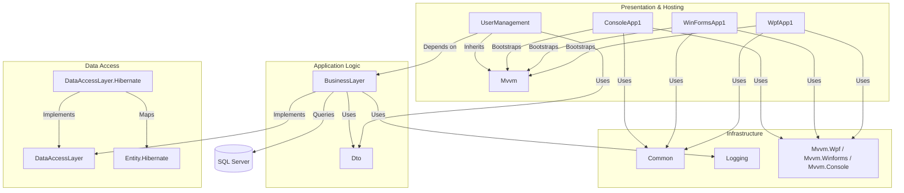

# User Management Application

## Overview

This repository provides a cross-platform .NET application suite for managing user records. It solves the problem of handling user data persistence and validation across different desktop environments by decoupling business logic from presentation frameworks.

The solution is designed for developers who need to maintain a single codebase for user management logic while deploying it via WPF, WinForms, or Console hosts. Its distinctive architectural feature is the heavy use of the Managed Extensibility Framework (MEF) for dependency injection and module composition. This allows the core business and view model logic to remain completely agnostic to the specific UI technology, enabling the same services and view models to run in a graphical interface or a headless console environment without code changes.

## Repository Description

A modular .NET user management application suite demonstrating MEF-based composition and MVVM architecture across WPF, WinForms, and Console hosts.

## Architecture Overview

The system is built around a strict layering of abstractions. The `UserManagement` module contains the feature-specific view models and messaging logic. These view models depend on the `BusinessLayer` for service logic and the `Mvvm` core for base classes. The `BusinessLayer` interacts with the `DataAccessLayer` contracts, which are implemented by `DataAccessLayer.Hibernate` to communicate with a SQL Server database via NHibernate.

The primary flow of control begins in the host application (e.g., `WpfApp1`). The host bootstraps a MEF composition container using utilities from the `Common` assembly. This container scans all loaded assemblies to discover exports. It resolves the `IModuleController` exported by the host, which in turn resolves the `IUserViewModel` from the `UserManagement` module. This resolution triggers the composition of the entire object graph: the view model imports `IUserService`, which imports `IRepositoryFactory`, which finally connects to the NHibernate session factory. Data requests flow down through these layers to the database, and results flow back up as Data Transfer Objects (DTOs).

A key design decision is the separation of the `DataAccessLayer` (contracts) and `DataAccessLayer.Hibernate` (implementation). This ensures that `BusinessLayer` and `UserManagement` do not reference NHibernate directly. Similarly, the `Mvvm` project defines framework-agnostic interfaces like `IMessageService`, while platform-specific projects (`Mvvm.Wpf`, `Mvvm.Winforms`, `Mvvm.Console`) provide the concrete implementations. This allows the view models to display messages or errors without knowing whether they are running in a WPF window or a console terminal.

## Main Components

*   **UserManagement**: This module contains the feature-specific view models (`UserViewModel`, `AddUserViewModel`, `ShowUsersViewModel`) and the data model. It uses MEF to compose the root view model from its children and uses `WeakReferenceMessenger` to decouple sibling components (e.g., notifying the list view when a user is added). It depends on [BusinessLayer](BusinessLayer.md) for data operations and [Mvvm](Mvvm.md) for base classes.
*   **BusinessLayer**: The service layer that encapsulates business rules. It contains [UserService](BusinessLayer/UserService.md), which handles user creation and retrieval, and [RepositoryFactory](BusinessLayer/RepositoryFactory.md), which bridges the business layer to the data access layer. It depends on [DataAccessLayer](DataAccessLayer.md) contracts and [Logging](Logging.md) for diagnostics.
*   **Mvvm**: The framework-agnostic core of the application. It defines the base view model classes (like [ViewModelBase](Mvvm/ViewModelBase.md)) and critical interfaces such as [IModuleController](Mvvm/IModuleController.md) and [IMessageService](Mvvm/IMessageService.md). This project allows the same view models to run in WPF, WinForms, or Console hosts.
*   **DataAccessLayer**: A contract-only project defining the repository pattern interfaces, such as [IRepository](DataAccessLayer/IRepository.md) and [IRepositoryFactory](DataAccessLayer/IRepositoryFactory.md). It ensures that higher layers do not depend on specific ORM implementations.
*   **DataAccessLayer.Hibernate**: The NHibernate-specific implementation of the data access contracts. It contains [HibernateRepository](DataAccessLayer.Hibernate/HibernateRepository.md) and [HibernateRepositoryFactory](DataAccessLayer.Hibernate/HibernateRepositoryFactory.md), which manage the session factory and transaction scopes. It depends on [Entity.Hibernate](Entity.Hibernate.md) for mapping definitions.
*   **Dto**: The data transfer layer. It defines [UserDto](Dto/UserDto.md) and the [IUser](Dto/IUser.md) interface, along with FluentValidation rules. This separates the UI's view of a user from the persistence entity, allowing the two to evolve independently.
*   **Common**: A shared utility assembly providing cross-cutting concerns. It contains [CompositionHelper](Common/Composition.md) for bootstrapping the MEF container, as well as diagnostic and imaging utilities. All host applications depend on this project to initialize their dependency injection containers.

## Features

*   **Cross-Platform MVVM**: A single set of view models that function in WPF, WinForms, and Console applications.
*   **MEF-Based Composition**: Uses the Managed Extensibility Framework to wire up services, view models, and module controllers at runtime.
*   **Decoupled Data Access**: Implements the Repository pattern with NHibernate, isolating business logic from database specifics.
*   **Cross-Component Messaging**: Uses `WeakReferenceMessenger` to allow sibling view models to communicate without direct references.
*   **Platform-Specific Messaging**: Provides consistent user feedback (alerts, errors) via `IMessageService`, with different implementations for console, WPF, and WinForms.

## Technology Stack

*   **Language**: C# (.NET 10)
*   **UI Frameworks**: WPF, Windows Forms
*   **Dependency Injection**: MEF (Managed Extensibility Framework)
*   **ORM**: NHibernate
*   **Database**: SQL Server
*   **Validation**: FluentValidation
*   **Logging**: Serilog
*   **Testing**: MSTest, Moq

## Use Cases

*   Developing a Windows desktop application that needs to display and manage a list of users with form validation.
*   Creating a headless service or script that needs to interact with the same user data and business rules as the desktop apps.
*   Refactoring a monolithic desktop app to decouple business logic from the UI framework for better testability.
*   Implementing a plugin architecture where new features are added as modules discovered by MEF at runtime.

## Contents
- [BusinessLayer/](BusinessLayer.md)
- [Common/](Common.md)
- [ConsoleApp1/](ConsoleApp1.md)
- [DataAccessLayer/](DataAccessLayer.md)
- [DataAccessLayer.Hibernate/](DataAccessLayer.Hibernate.md)
- [Dto/](Dto.md)
- [Entity.Hibernate/](Entity.Hibernate.md)
- [Logging/](Logging.md)
- [Mvvm/](Mvvm.md)
- [Mvvm.Console/](Mvvm.Console.md)
- [Mvvm.Winforms/](Mvvm.Winforms.md)
- [Mvvm.Wpf/](Mvvm.Wpf.md)
- [TestProject1/](TestProject1.md)
- [UserManagement/](UserManagement.md)
- [WinFormsApp1/](WinFormsApp1.md)
- [WpfApp1/](WpfApp1.md)